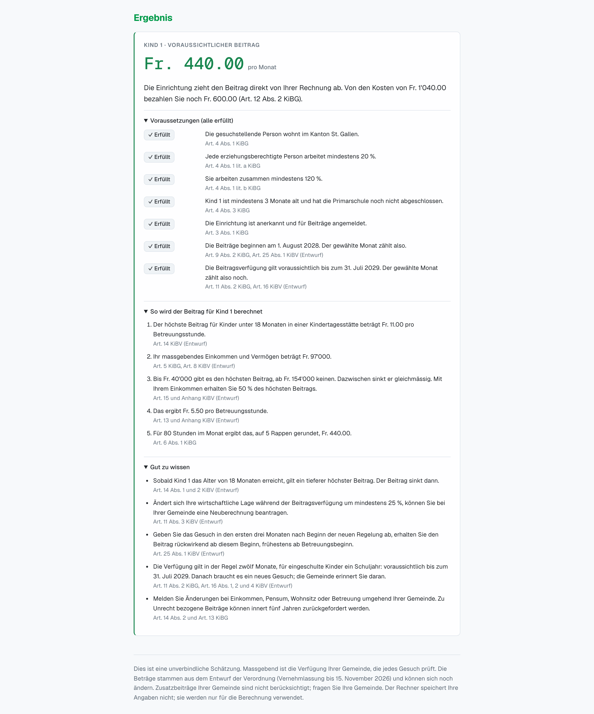

# KiBG Calculator St. Gallen

**Rules as Code for the new childcare contributions in the Canton of St. Gallen**

Team Ctrl+Alt+Elite: Karla Ruggaber, Benjamin Pfister, Rea Graf, Julian Böhi
Legal Hackathon 2026, challenge "Making childcare support understandable with OpenFisca" (Law & Tech Entrepreneurs, University of St. Gallen)

Sooner or later, every parent in St. Gallen who needs childcare asks the same things. Do we get money? How much? And why? The answers are in the new childcare law (KiBG) and its draft ordinance (KiBV), spread over fifteen pages, a formula with six variables and a 30-day deadline. We wrote the rules of both texts in OpenFisca, line by line, and tested them against cases we had worked out by hand first. The website sits on top of that model. It asks a family a few questions and explains the result with the articles behind it.

Take the Keller family. One parent works 100 %, the other 40 %, their relevant income is Fr. 97'000, and their one-year-old spends 80 hours a month in a Kita that costs Fr. 1'040. They receive **Fr. 440 per month**, half from the canton and half from the municipality. The parents still pay Fr. 600.



This README is the short version. For the details, including the complete reasoning behind our assumptions and a screenshot of every tab, see the full legal and technical report in [`docs/KiBG-Calculator_Report.md`](docs/KiBG-Calculator_Report.md) (also available as a [Word file](docs/KiBG-Calculator_Report.docx)).

## Contents

1. [The problem](#1-the-problem)
2. [Our solution](#2-our-solution)
3. [Legal basis and scope](#3-legal-basis-and-scope)
4. [How it works](#4-how-it-works)
5. [Getting started](#5-getting-started)
6. [Tests and checks](#6-tests-and-checks)
7. [Repository structure](#7-repository-structure)
8. [From law to code](#8-from-law-to-code)
9. [Responsible design](#9-responsible-design)
10. [Limitations and next steps](#10-limitations-and-next-steps)
11. [Team, AI use and open source](#11-team-ai-use-and-open-source)
12. [Further documentation](#12-further-documentation)

## 1. The problem

When legal rules get written down, the style of the language is rarely adapted to the people affected. The majority of them are considered laypeople and are not used to dealing with the legal language. Legislation is often spread over several acts. Rules refer to one another constantly and use terms that mostly make sense to qualified lawyers.

The new childcare law of St. Gallen shows this as well. On 14 June 2026 the voters accepted the fully revised KiBG with 57.8 % yes. The principle is straightforward: instead of lump sums to the municipalities, families receive a contribution per child and per hour of care, calculated in the same manner across the whole canton of St. Gallen. More details can be found in the associated ordinance (KiBV), which still is a draft and open for consultation until 15 November 2026. The new system is planned to start on 1 August 2028.

For most parents the application of these rules turns out rather challenging. Whether they are entitled at all depends on how much both of them work, where they live, the age of their child and the type of care facility their kid is in. The amount then depends on the "massgebendes Einkommen", which is defined in yet another ordinance, on seven different hourly rates and on a formula in the annex of the KiBV. One detail is easy to miss and can trigger a chain of costly consequences. If the application is filed more than 30 days after care begins, the first weeks are not paid. Only a few parents will work through fifteen pages of legal text to find this out.

This is the exact situation our tool is built for. A family might be about to apply, or is even still deciding if they want to place their kid in a Kita. Before committing, financial considerations will most likely occur. Parents probably want to know whether they are entitled, how much they will receive and why, and what they need to do next.

## 2. Our solution

Our approach is Rules as Code. Next to the legal text, we wrote the same rules a second time as program code, which software can run and our tests check against the law.

Reuse is the main benefit. Once the rules are encoded and tested, other applications and use cases can build on the same model without going through the law again. A municipality could plug the model into its case software. The canton could run budget simulations with it, and a French version of the site would use it too. The answer would be the same everywhere. When the law changes, the rules change in one place, and the tests show straight away whether everything still holds.

The website is in German and has four tabs:

| Tab | What it does |
|---|---|
| Rechner | Questionnaire for one family. Shows the expected contribution per child and month, what the parents still pay, each condition with its article, the calculation in francs and hints on what to do next |
| Vergleichstool | "Does working more pay off?" Parents mark their working half-days in a weekly grid. The tool varies one parent's workload, compares Kita, Tagesfamilie and after-school care, and shows what is left of the extra wage after childcare (before tax) |
| Überblick | The way to the contribution in six steps: what parents do, what happens without them, and the 30-day deadline on a timeline |
| Gesetzgebung | Full text of the KiBG and the KiBV draft. Every article reference on the site jumps to the exact paragraph |

We had families in mind who have not applied yet. Municipalities could use the same model to check applications and explain their decisions; the canton could use it in the consultation and later for budget simulations (Art. 17 KiBG).

## 3. Legal basis and scope

| Act | Version we used | Status (8 Nov 2026) |
|---|---|---|
| KiBG (Gesetz über Beiträge für familien- und schulergänzende Kinderbetreuung) | [`challenge/Gesetz.pdf`](challenge/Gesetz.pdf), text after the first reading of 16 Sept 2025 | Adopted 14 June 2026, start date not set yet |
| KiBV (Verordnung) | [`challenge/Verordnung.pdf`](challenge/Verordnung.pdf), RRB 2026/733 | Draft, consultation until 15 Nov 2026 |

The revision of the legislation is not in force yet. The official website of the Canton of St. Gallen states that, from 1 August 2028, families will receive a minimum subsidy across the canton under the new Childcare Act. The Government has put the related ordinance out for consultation. Until the date is officially set, we use 1 August 2028 as a placeholder, and every reference to the ordinance in the code carries the label "(Entwurf)".

Whenever the legal text left room for more than one answer, we sat down in the team and discussed potential questions. We use four labels to show where an answer comes from. "Law / ordinance (draft)" means the text itself answers the question. An interpretation (O1–O12) means the wording allows more than one reading. In these cases we chose the one that seemed the most convincing to us and gave our reasons. An assumption (A1–A12) fills a gap where the text says nothing. Discretion means a person at the municipality decides; in the model, that is always an input and never a formula.

We went through both acts article by article, down to every paragraph and letter, and sorted each provision into one of four groups. The complete list can be found in the rule inventory [`challenge/line-to-line-rules.md`](challenge/line-to-line-rules.md).

| Group | Examples |
|---|---|
| Encoded as rules | Entitlement (Art. 3–4 KiBG), income (Art. 5 KiBG, Art. 8 and 11 KiBV), rates and formula (Art. 13–15 KiBV, annex), hour and cost caps, split between canton and municipality, start of contributions (Art. 9 KiBG, Art. 6 and 25 KiBV), length of a decision (Art. 11 KiBG, Art. 16 KiBV) |
| Only an input | Recognition of the facility, exception from the minimum workload, the relevant income itself, municipal supplements Z1 and Z2 |
| Not encoded yet | Recalculation during a decision (Art. 11 Abs. 3 KiBV), the five-days-a-week limit, the budget of Art. 17 KiBG, repayment (Art. 13 KiBG) |
| Not computable | Platform, data protection, payment flows, duties to cooperate |

## 4. How it works

```
SvelteKit website  ── POST /calculate ──▶  OpenFisca Web API
(questions, texts,  ◀── numbers, yes/no ──  (model: entities, parameters,
 explanations)                               variables, 125 tests)
```

All legal logic sits in the OpenFisca model; the website only translates. On its server it builds an OpenFisca "situation" from the form, sends it to `/calculate` and writes the numbers that come back as sentences. Nothing is stored.

The model calculates each child and month separately, in seven steps:

1. Entitlement. The applicant lives in the canton. Each parent works at least 20 % and, in a shared household, both together at least 120 % (unless the municipality granted an exception). The child is between 3 months old and the end of primary school, and the facility is recognised and registered.
2. Relevant income. In a shared household, both parents' incomes. With separated parents, the applicant's income plus that of a partner in a "gefestigte Lebensgemeinschaft".
3. Maximum rate per hour, by age and type of care (Fr. 11.00 for a Kita under 18 months, then Fr. 7.50, and so on).
4. Contribution per hour: maximum rate × income factor. The factor is 1 up to Fr. 40'000 and falls in a straight line to 0 at Fr. 154'000.
5. Subsidised hours: at most 12 per care day.
6. Cost cap: never more than the actual costs.
7. Split: canton and municipality pay half each, and the parents pay the rest.

For the Keller family this looks as follows:

| Step | Calculation | Result |
|---|---|---|
| Income | 60'000 + 37'000 | Fr. 97'000 |
| Income factor | 1 − (97'000 − 40'000) / 114'000 | 0.5 |
| Rate | Kita, under 18 months | Fr. 11.00 |
| Per hour | 11.00 × 0.5 | Fr. 5.50 |
| Per month | 5.50 × 80 hours | **Fr. 440** |
| Parents pay | 1'040 − 440 | **Fr. 600** |

The model has 65 variables (37 formulas and 28 inputs) and 23 parameters. Every one of them names the article it is based on.

If a relevant input is missing, the model stops with an error that names the field, and the website asks for that answer instead of showing an amount. The same happens with combinations that cannot exist, such as care hours without care days or a baby marked as being at school. Decisions that belong to the authorities, for example an exception from the minimum workload or the recognition of a facility, are always asked as inputs and are not derived by the model.

## 5. Getting started

You need `git`, `bash`, [uv](https://docs.astral.sh/uv/) and Node.js 22. We worked with these versions:

| Tool | Purpose | Version |
|---|---|---|
| OpenFisca Core (with Web API) | Rules engine and API | 44.7.1 |
| Python | Model | 3.9 or later (tested with 3.10) |
| SvelteKit, Svelte, Vite | Website | 3.1, 5.57, 8.3 |
| marked, marked-footnote | Rendering the legal texts | 18.1.1, 1.4.0 |
| ruff, yamllint, pre-commit | Automated checks | 0.16.8, 1.38.0, 4.6.2 |
| Node.js | Website and website tests | 22 |

```bash
# once: installs OpenFisca, the checks and the git hooks
bash tools/setup.sh

# terminal 1: OpenFisca Web API on http://127.0.0.1:5000
cd openfisca-CH-SG && make serve-local

# terminal 2: website on http://localhost:5173
cd frontend && npm install && npm run dev
```

On macOS, port 5000 is often taken by AirPlay. If that happens, start the API on a different port and tell the website where to find it:

```bash
cd openfisca-CH-SG && uv run openfisca serve --country-package openfisca_ch_sg --port 5001
cd frontend && OPENFISCA_URL=http://127.0.0.1:5001 npm run dev
```

To query the API directly with the Keller family:

```bash
curl -X POST -H "Content-Type: application/json" \
  -d @openfisca-CH-SG/openfisca_ch_sg/situation_examples/p1_paar_kita.json \
  http://127.0.0.1:5000/calculate
```

## 6. Tests and checks

```bash
cd openfisca-CH-SG && make test     # 125 OpenFisca tests
cd frontend && npm test             # 27 website tests (14 of them need the API running)
```

The expected amounts were calculated by hand, from the law, before any code existed. That way the tests compare the code with the law and not with itself. The cases are taken from the scenario catalogue [`challenge/szenarien.md`](challenge/szenarien.md):

| File | Content |
|---|---|
| `tests/personas.yaml` | Seven example families (P1–P7b) |
| `tests/grenzfaelle.yaml` | Boundary cases, cases without entitlement, interpretation cases, known limits |
| `tests/datumsregeln.yaml` | Start of contributions, facility participation, length of a decision |
| `tests/test_eingabefehler.py` | Inputs that must stop the calculation, e.g. a missing date of birth |
| `tests/test_vollzugsbeginn.py` | The placeholder start date is the same everywhere |

`ruff` and `yamllint` run on every commit. Every push adds all OpenFisca tests and our own checker (`tools/check_openfisca.py`), which warns, for example, when a rule has no article reference or a KiBV reference is missing "(Entwurf)". GitHub Actions then runs the same checks once more. On 8 November 2026 all tests passed (OpenFisca Core 44.7.1, Node 22).

## 7. Repository structure

```
challenge/            challenge material: KiBG, KiBV draft, pitch,
                      rule inventory (line-to-line-rules.md), scenario catalogue (szenarien.md)
openfisca-CH-SG/      the OpenFisca model
  openfisca_ch_sg/
    entities.py       household with parents, children and partner
    parameters/kibg/  all values from the text, each with its article
    variables/        inputs and formulas, one file per topic
    tests/            hand-calculated test cases
frontend/             SvelteKit website
  src/lib/texte.de.json   all texts of the calculator, editable without code
  src/lib/recht/          KiBG and KiBV as Markdown with an anchor per paragraph
docs/                 decision log, legal design document, output concept
tools/                setup script, rulebook checker, decision-log generator
RULEBOOK.md           how we write the rules in code and what is checked
```

## 8. From law to code

We followed OpenFisca's "line-to-line" principle: one provision, one element. Every condition or value in the text became its own variable or parameter, named with the German legal term and linked to its article. Where the law says the same thing twice, as it does with the cost cap in Art. 6 Abs. 2 and Art. 20 Abs. 3 KiBG, the code says it twice as well. That way the lawyers on the team could put code and text side by side and tick off each line.

Our process had seven steps:

1. Read KiBG and KiBV in full, then narrow the focus to what affects a family: entitlement, amount and deadlines.
2. Assign every paragraph to an OpenFisca building block in the rule inventory, or mark it as input only or not encoded, with a reason.
3. Decide openly where the text is unclear (interpretations O) or silent (assumptions A).
4. Calculate example families and edge cases by hand. These became the tests.
5. Write the model in OpenFisca.
6. Build the website that asks the questions and explains the answer.
7. Check code and texts against the law one last time. Every decision is recorded in a commit message and ends up in the decision log.

Interpretations and assumptions are not the same thing. We needed an interpretation (O) wherever the wording allows more than one reading; we chose one and gave our reasons. We needed an assumption (A) wherever the text says nothing, and then we filled the gap ourselves. Each of them is also a test case. The reasoning for O is in the rule inventory, for A in the scenario catalogue.

| No. | Question | Our decision |
|---|---|---|
| O1 | Start date not set ("ab ●●") | Placeholder 1 August 2028 |
| O2 | A child of exactly 18 months is neither "under" nor "over" 18 months | Higher rate for the full first 18 months |
| O3 | Is 120 % together enough if one parent works less than 20 %? | No, lit. a and b apply together: each parent at least 20 % |
| O4 | Does "no contribution above Fr. 154'000" also apply to the supplement Z2? | No, Z2 is income-independent and still paid |
| O5 | Relevant income is defined in the V EG-KVG, which we don't have | Entered by the user |
| O6 | Our law PDF is the first-reading text | Open, to be checked against the adopted text |
| O7 | How does "5 days per week" work with monthly figures? | Hours per month are entered; the 5-day limit is not checked |
| O8 | Which parent must live in the canton if they are separated? | The applicant; the applicant's municipality is responsible |
| O9 | When does the school year start? | 1 August |
| O10 | Alternating custody: who applies? | Each parent for their own custody days |
| O11 | Which rate for private special schools? | The rate of the form of care (after-school care) |
| O12 | Does the 25 % income change also count upwards? | Yes, in both directions |

O3 has the biggest effect. Read the other way, a couple working 120 % and 0 % would be entitled. We read lit. a and b together for four reasons. The wording requires each parent to work. The 120 % builds on the 20 % minimum. Couples should not face a lower threshold than single parents (Art. 8 BV). And a parent who does not work at all can usually look after the child.

| No. | Assumption |
|---|---|
| A1 | Age of the child and length of a partnership are determined on the first day of the month |
| A2 | If minimum contribution and municipal supplement together exceed the costs, the supplement is cut first |
| A3 | The limit of five care days per week is not checked |
| A4 | Monthly amounts are rounded to 5 Rappen; the hourly rate is not rounded; the cost cap applies after rounding |
| A5 | Parents only enter days and hours with actual custody |
| A6 | Each parent works at least 20 %, and parents in a shared household at least 120 % together (see O3) |
| A7 | A deadline in days starts the day after the event; a deadline in months ends on the day with the same number |
| A8 | A child counts as enrolled in school from entry into compulsory kindergarten |
| A9 | In the month contributions start, only care days and hours from that date are entered |
| A10 | The application date is the day it is handed in at the municipality or posted |
| A11 | The decision starts when the contributions start (provisional) |
| A12 | If a decision ends mid-month, only care days up to that date are entered (provisional) |

Some questions are not ours to answer. Whether a family gets an exception from the minimum workload, whether a facility is recognised, what the relevant income is: the authorities decide these. The calculator asks for them and never guesses.

Writing the rules as code also exposed weak spots in the texts themselves. We found 24 places where the law or the draft is unclear or inconsistent. Seven of them matter most for families, and each could be fixed with a single sentence in the ordinance:

| No. | Provision | Issue | Effect (example) |
|---|---|---|---|
| U11 | Art. 5 Abs. 4 KiBG / Art. 11 KiBV | Law: current income counts if it changed a lot. Ordinance: only on request | Fr. 725.60 instead of Fr. 416.85 per month if income rose and nobody asks |
| U15 | Art. 11 KiBG, Art. 16 KiBV | Does the rate drop during a decision when the child turns 18 months? | Up to Fr. 140 per month |
| U17 | Art. 9 Abs. 2 KiBG | Which start of care counts for follow-up applications? | Fr. 450 lost in our example |
| U13, U14 | Art. 6 KiBG, Art. 14 KiBV | Do meals count as costs? Booked or attended hours? | Fr. 1'100 vs. 1'000; Fr. 440 vs. 330 |
| U2 | Art. 23 lit. f KiBG | No rule for care outside the canton | After-school care across the border hardly possible |
| U7 | Art. 8 KiBV | Single parent without a second parent: does a partner's income count? | Fr. 270 vs. Fr. 486 |
| U9 | Art. 4 Abs. 2 KiBG / Art. 12 KiBV | Ordinance allows exceptions for people without any job, the law does not clearly | Fr. 594 vs. nothing |

The full list, with examples, is in Part 7 of the scenario catalogue. We think these points belong in the consultation.

## 9. Responsible design

Regarding personal information, the calculator only asks what it requires in order to start calculating. Names (children are "Kind 1", "Kind 2"), an address or an AHV number are not needed. Personal data is not stored. We did stop short of promising that no data is stored anywhere, because that depends on where the API will be hosted and what its server logs. Art. 8 KiBG provides information on the Canton’s own data processing. The responsible cantonal and municipal bodies may process personal data, including particularly sensitive personal data and personality profiles, via the platform, and disclose it to one another and to the institutions, insofar as this is necessary for the implementation of this Act (Art. 8 Abs. 1 KiBG).

In the process of designing our product, we did consider implementing a chatbot for follow-up questions. Eventually, we decided against it. The data a family enters into our program is considered sensitive. It contains information about income, work, separation, custody, and sometimes also the reason for an exception. A chatbot would send it to an external AI provider, which did not align with our attitude towards our program. Even though our product is built around technology, it was important to us to make it as human as possible and to stand by our beliefs. We doubt our users would like for their data to be shared, which is why we tried to handle it as carefully as possible.

There is no login, no account and no database. Only the website's server calls the OpenFisca API, and wrong or impossible inputs stop the calculation instead of producing a number. The binding decision remains with the municipality (Art. 11 KiBG), and every result says so. For accountability, every rule has its article, and every decision has its reason and its author in the decision log.

The legal status is always visible, from the draft ordinance to the placeholder start date. Each result shows its conditions and its calculation, and the article links lead to the exact paragraph.

We also checked whether our simplifications put certain groups at a disadvantage. Where the text leaves a group unclear, such as single parents without a second parent (U7), we raised and discussed the question openly. Quietly choosing the reading that pays less was not an option for us.

The website uses plain language and the polite "Sie". The 30-day deadline is the rule most likely to cost a family money without anyone noticing, so it appears in the result and again on a timeline in the overview. When the calculator says "no", it names the condition that failed. If that condition is the workload, it points to the exception the municipality can grant.

Some limits remain. The five-days-a-week limit is not checked. The child's age is taken on the first of the month. The family types in its income itself, and each child has one form of care per month. All amounts may still change after the consultation.

## 10. Limitations and next steps

Some work is still open. The law PDF we used is the text after the first reading; it still has to be compared with the version adopted on 14 June 2026. We have not yet decided on hosting or logging, and no security review has been done. When the start date is officially set, it has to be updated in three places in the code, and a test makes sure all three match.

The adoption of the ordinance (KiBV) after the consultation will mean more work. Whatever differs from the draft has to be carried into the model. Since each value is stored once as a parameter with its article, this should mostly be a matter of editing parameter files and running the tests again.

Several extensions would make sense. Each municipality could enter its own supplements Z1 and Z2. The relevant income could be calculated from tax data instead of being typed in by the family. For the canton, a budget simulation for the 20 million francs of Art. 17 KiBG would be useful, and for families, a recalculation during a running decision. Versions of the website in English, French and Italian would not require any change to the model, because all texts are kept in separate files.

## 11. Team, AI use and open source

Two of us study computer science and two study law, and we divided the work along that line. Benjamin and Karla wrote the rules in code and built both the backend (the OpenFisca model) and the frontend (the website). They regularly reviewed each other's code changes, gave feedback and implemented missing parts, and this four-eyes principle worked very well for us. Rea and Julian analysed the law and, using the concepts of Rules as Code, mapped it accordingly. They also settled every open legal question: what is unclear in the texts, how to interpret it, and which assumptions to make. Julian presents the project in the pitch, with Benjamin supporting the presentation, and Karla and Rea wrote the README and the full report.

| Member | Main contributions |
|---|---|
| Karla Ruggaber | Initial GitHub setup (forking the repository, uploading all relevant files), line-to-line rule inventory and hand-calculated scenario catalogue, date rules, comparison tool, legislation tab, frontend tests, README and full report (with Rea) |
| Benjamin Pfister | Rulebook, checker and automated checks, core model, duration of decisions, tests from the catalogue, output concept, calculator interface and design, support for the presentation |
| Rea Graf | Legal analysis of KiBG and KiBV, high-level mapping of the law, all open legal questions: interpretations O1–O12, assumptions A1–A12 and unclear provisions U1–U24 with their legal reasoning, README and full report (with Karla) |
| Julian Böhi | Legal analysis of KiBG and KiBV, high-level mapping of the law, all open legal questions: interpretations O1–O12, assumptions A1–A12 and unclear provisions U1–U24 with their legal reasoning, presentation and pitch |

**Statement of Author Contribution and AI Use.** All four of us are responsible for the whole project, and each of us can explain every part of it, including the parts where AI was used. We used one AI tool, Claude (Anthropic), mostly as Claude Code inside the repository. Every single use is recorded in the commit messages and listed in Section 6 of [`docs/CHANGELOG_DECISIONS.md`](docs/CHANGELOG_DECISIONS.md). In summary:

| Purpose | Specific uses |
|---|---|
| Setting up tooling | Drafted the rulebook, the rulebook checker, the decision-log generator, the git hooks and the GitHub workflows, following our instructions |
| Writing code from our legal specification | Wrote `entities.py`, the parameter files and the variables from our rule inventory; applied renames; split merged provisions after our line-to-line review; encoded the date rules and the duration of decisions |
| Tests | Converted our hand-calculated scenarios into OpenFisca tests; added input-error tests; checked rounding with a sweep of values |
| Reviewing code against the text | Compared Art. 5, 8 and 11 with the wording and flagged deviations, which we then decided on |
| Options for decisions | Prepared options for the output concept (points 7 to 13); the team chose |
| Texts and interface | Drafted the interface texts from our output concept (then revised by the team); drafted the legal design document from our rule inventory and scenarios (checked by the team); built the SvelteKit interface and the overview tab from the team's content; tested pages in a headless browser |
| Full report | Drafted the full report in English from our repository, decision log, rule inventory and scenario catalogue; the team then reviewed and edited it |
| This README | Drafted this README from the report and the repository; the team then reviewed and edited it |

The legal analysis is our own. That covers the classification of every provision in the rule inventory, the hand calculations in the scenario catalogue, all interpretations (O1–O12) and assumptions (A1–A12), and the list of unclear provisions. When the AI proposed an interpretation, it was marked as provisional and only became final after a team decision. Code was accepted only once it passed the tests, and the expected values in those tests had been calculated by hand before the code existed.

Open source and external resources we used:

| Resource | Use | Licence |
|---|---|---|
| OpenFisca Country Template, OpenFisca Core | Model and Web API | AGPL-3.0 |
| SvelteKit, Svelte, Vite | Website | MIT |
| marked, marked-footnote | Rendering the legal texts | MIT |
| Geist, Geist Mono | Typeface | SIL Open Font License |
| uv, ruff, yamllint, pre-commit | Environment and checks | Open source |
| Photo of St. Gallen (Home tab) | Decoration | [source to be added] |
| KiBG, KiBV draft, pitch, OpenFisca introduction | Challenge material | Canton of St. Gallen, legalhackathons.org |

## 12. Further documentation

The full report is the most complete document. The other files are the working documents we actually built the project with.

| File | Content |
|---|---|
| [`docs/KiBG-Calculator_Report.md`](docs/KiBG-Calculator_Report.md) ([Word](docs/KiBG-Calculator_Report.docx)) | Full legal and technical report: problem, process, model, legal reasoning, responsible design, the full reasoning for assumptions A1–A12, screenshots of the Keller family |
| [`challenge/line-to-line-rules.md`](challenge/line-to-line-rules.md) | Rule inventory: every provision assigned to code, interpretations O1–O12 |
| [`challenge/szenarien.md`](challenge/szenarien.md) | Scenario catalogue with hand calculations, assumptions A1–A12, unclear provisions U1–U24 |
| [`docs/CHANGELOG_DECISIONS.md`](docs/CHANGELOG_DECISIONS.md) | All decisions with reason, source and author; table of encoded articles; AI use |
| [`docs/legal-design.md`](docs/legal-design.md) | Plain-language explanation for families with decision tree and the Keller example |
| [`docs/output-konzept.md`](docs/output-konzept.md) | How the calculator presents its result |
| [`RULEBOOK.md`](RULEBOOK.md) | Coding conventions and automated checks |
| [`openfisca-CH-SG/README.md`](openfisca-CH-SG/README.md) | The model in detail, including the provisions that are not encoded |
| [`frontend/README.md`](frontend/README.md) | The website in detail |

## Licence

The OpenFisca model is based on the OpenFisca Country Template and licensed under AGPL-3.0 (see [`openfisca-CH-SG/LICENSE`](openfisca-CH-SG/LICENSE)).
