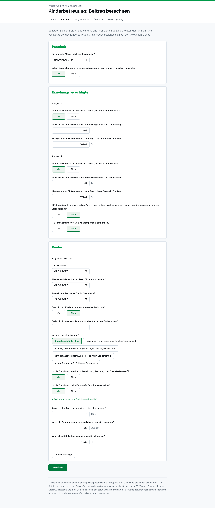
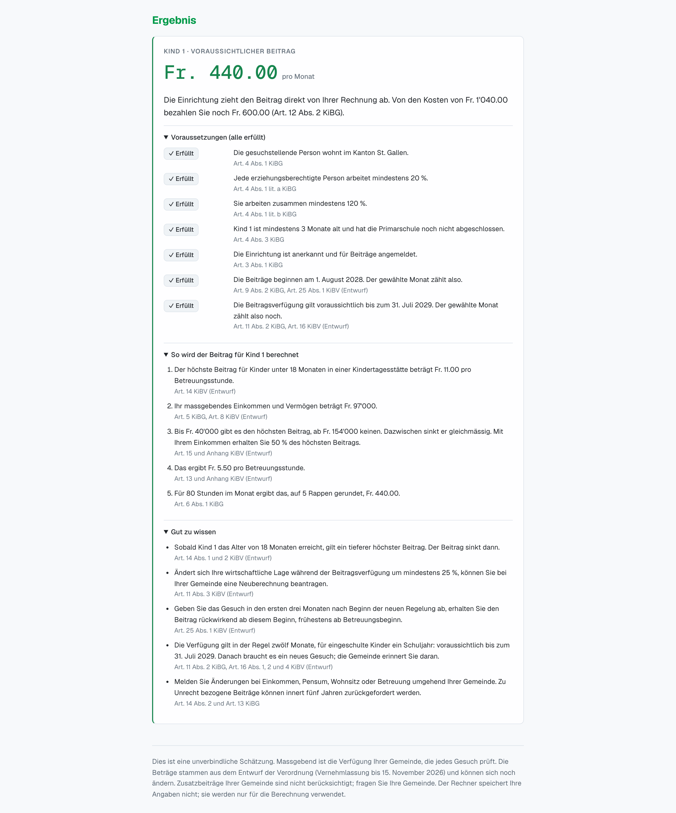
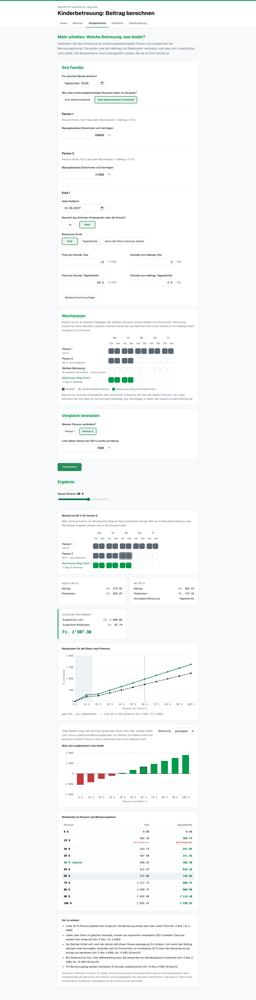
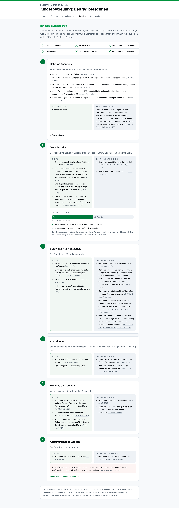
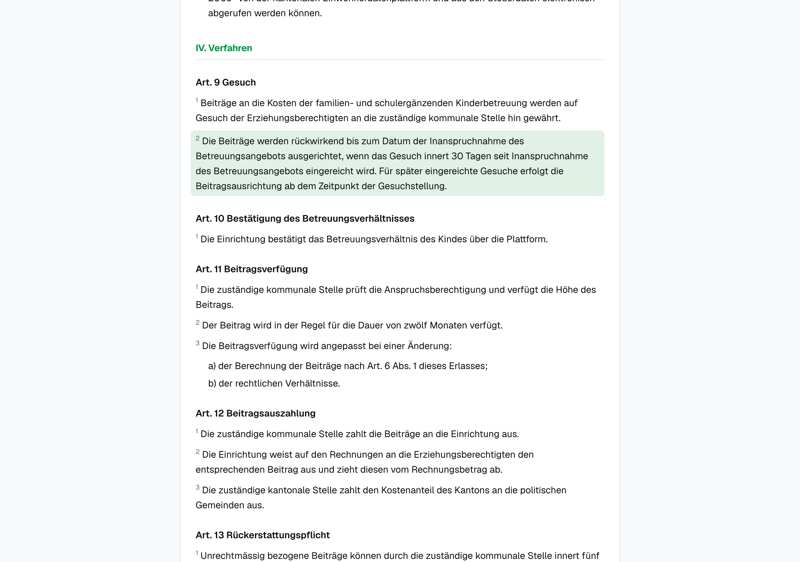

# KiBG Calculator St. Gallen: Legal and Technical Documentation

**Making childcare support understandable with OpenFisca**

| | |
|---|---|
| Team | Ctrl+Alt+Elite |
| Members | Karla Ruggaber, Benjamin Pfister, Rea Graf, Julian Böhi |
| Challenge | Making childcare support understandable with OpenFisca (Canton of St. Gallen, legalhackathons.org) |
| Course | Law & Tech Entrepreneurs 2026, University of St. Gallen |
| Repository | https://github.com/Benjam1nP/Legal_Tech_Hackathon |
| Submitted | 8 November 2026 |
| Legal basis used | KiBG adopted 14 June 2026 (text of the first reading, 16 September 2025); KiBV draft, RRB 2026/733 (consultation until 15 November 2026) |

---

## Summary

In June 2026 the voters of St. Gallen adopted a fully revised law on childcare contributions (KiBG). The details sit in an implementing ordinance (KiBV) that is still a draft. Together the two texts run to about fifteen pages, and the amount a family receives depends on a formula with six variables, an income definition borrowed from yet another ordinance, and a 30-day deadline that decides whether the money is paid retroactively. For a family thinking about a Kita place, it is hard to find out whether they qualify and how much they would get.

During the hackathon we built a Rules as Code prototype. We wrote the entitlement and calculation rules of the KiBG and the draft KiBV in OpenFisca and put a website on top of the model. Law and code match line by line, and 125 tests that we calculated by hand from the text check that the code does what the law says. The website has four parts: a calculator for one's own family, a comparison tool that shows what is left of an extra working day after childcare costs, a six-step overview of the application process, and the full text of both acts with a direct link to every paragraph. The website does not calculate anything itself. It asks the questions, sends the answers to the model and explains the result.

For our reference family (the Kellers: two parents at 100 % and 40 %, a relevant income of Fr. 97'000, a one-year-old in a Kita for 80 hours a month at Fr. 1'040) the model returns a contribution of Fr. 440 per month, paid half by the canton and half by the municipality, so the parents still pay Fr. 600. Every step of that result is traceable to an article. While coding we also found 24 places where the texts are unclear or inconsistent. Seven of them have a measurable effect on families and are suitable for the consultation on the ordinance, which closes on 15 November 2026.

Put in one sentence: we took the question that families actually have, "Do we get money, how much, and why?", translated the law behind it into code that can be checked, and built a website that answers it.

As for the legal status, the KiBG has been adopted but its start date (Vollzugsbeginn) has not been set, and the KiBV is still a draft. We use 1 August 2028 as a placeholder start date.

---

## 1. Background and problem

### 1.1 The revision of the KiBG

Under the previous law of 29 November 2020, the canton paid its money to the municipalities according to their share of children aged 0 to 12, and each municipality decided how to pass it on to parents. What a family received therefore depended a good deal on where it lived. The revised Gesetz über Beiträge für familien- und schulergänzende Kinderbetreuung (KiBG) replaces this with a contribution per child and per hour of care, calculated the same way everywhere in the canton. The Kantonsrat passed the law, a parliamentary referendum was requested, and on 14 June 2026 the voters accepted it with 57.8 % yes. The government has not yet fixed the start date; the canton has said it plans to introduce the new system in 2028.

Most of the numbers are not in the law itself. The Verordnung (KiBV) sets the maximum rates per hour, the income limits, the formula, the cap of 12 hours per day, and the procedure. The draft ordinance was published in October 2026 and is open for comments until 15 November 2026.

### 1.2 Why this is hard for families and municipalities

The basic idea of the law is easy to explain: the lower the income and the younger the child, the higher the contribution. But before parents know what this means for their own family, they have to work out quite a lot:

- whether both parents work enough (at least 20 % each, and in a shared household at least 120 % together, Art. 4 Abs. 1 KiBG);
- whether the Kita is "recognised" and "registered" (Art. 3 KiBG), and since when (Art. 6 KiBV);
- what their "massgebendes Einkommen und Vermögen" (relevant income and assets) is, which the KiBV defines by reference to a health insurance ordinance (V EG-KVG, sGS 331.111) that most people have never heard of;
- whose income counts if the parents are separated or one of them has a new partner (Art. 8 KiBV);
- which of seven hourly rates applies (Art. 14 KiBV), and how the annex formula turns that rate into a contribution;
- whether the application is filed within 30 days of the first day of care, because otherwise contributions only start on the day of the application (Art. 9 Abs. 2 KiBG).

Municipalities have a similar problem from the other side. They will have to apply the rules to every application and explain the outcome to parents who disagree with it. Both would benefit from one shared and tested model of the rules.

### 1.3 The challenge and what we chose to do

The challenge asked teams to encode a selected part of the rules in OpenFisca and make it understandable, and to state which legal versions they used. It offered two sub-challenges: a calculator for families (access to justice) and a structured, reviewable representation of the rules (legal design). The organisers' wider aim was to help people know their rights, comment on the ordinance and suggest reforms, and their pitch spoke of creating a "digital twin" of the rules, which is what Rules as Code is about.

We combined both sub-challenges. Instead of encoding a small subset, we decided early to go through every provision of the KiBG and the KiBV and classify each one: encoded as a rule, encoded only as an input, computable but not encoded yet, or not computable at all. This made the scope larger, but it meant we could say with some confidence what the calculator covers and what it does not, and it is how we found most of the ambiguities discussed in Section 6.

### 1.4 Use case

We built the prototype around one situation. A family is about to apply, or is still deciding about a Kita place, and wants to know three things beforehand: whether they are entitled to a contribution, how much they will get and why, and what they have to do to receive it. Each part of the website is meant to answer one of these questions.

---

## 2. Legal basis and legal status

### 2.1 Versions used

| Act | Document we worked with | Status on 8 November 2026 |
|---|---|---|
| Gesetz über Beiträge für familien- und schulergänzende Kinderbetreuung (KiBG) | [`challenge/Gesetz.pdf`](https://github.com/Benjam1nP/Legal_Tech_Hackathon/blob/main/challenge/Gesetz.pdf), result of the first reading of 16 September 2025 | Adopted by popular vote on 14 June 2026; the government sets the Vollzugsbeginn (Ziff. IV Nr. 1), not yet done |
| Verordnung über Beiträge für familien- und schulergänzende Kinderbetreuung (KiBV) | [`challenge/Verordnung.pdf`](https://github.com/Benjam1nP/Legal_Tech_Hackathon/blob/main/challenge/Verordnung.pdf), RRB 2026/733 | Draft; consultation until 15 November 2026; applies "ab ●●" (Ziff. IV) |

There is one problem we could not solve during the hackathon. The PDF of the law is the text after the first reading in parliament, while the KiBV refers to the law "vom 14. Juni 2026". If the final text differs, some article numbers or values may be off (open question O6 / U23). We noted it as a question for the organisers and list it in Section 10.2 as the first thing to check.

The official collection of laws (sGS 221.1) still shows the old law of 29 November 2020 and will do so until the start date. For that reason our article links do not point there but to our own copy of the texts on the website (Section 3.2).

### 2.2 Keeping law, draft and our own choices apart

The challenge explicitly asked teams to distinguish rules in force from other rules. In our case nothing is strictly in force yet, so we used five labels instead of two, both in the rule inventory and in our legal design document ([`docs/legal-design.md`](https://github.com/Benjam1nP/Legal_Tech_Hackathon/blob/main/docs/legal-design.md)):

| Label | Meaning |
|---|---|
| Law | The KiBG says so (adopted, not yet applied) |
| Ordinance (draft) | The KiBV draft says so; may change after the consultation |
| Team interpretation (O1–O12) | The text allows two readings; we chose one and give our reasons |
| Team assumption (A1–A12) | The text is silent; we had to assume something so the model can calculate |
| Authority's discretion | A person at the municipality decides; in the model this is always an input, never a formula |

In the code, every reference to the ordinance carries "(Entwurf)", for example `Art. 14 Abs. 4 KiBV (Entwurf)`. Our automated checker warns if it is missing. The start date is a placeholder (1 August 2028, decision O1) and appears in three places in the code; a dedicated test fails if they ever disagree.

### 2.3 Scope

The rule inventory ([`challenge/line-to-line-rules.md`](https://github.com/Benjam1nP/Legal_Tech_Hackathon/blob/main/challenge/line-to-line-rules.md)) assigns every article, paragraph and letter of both acts to one of four groups. The table below summarises the result; the full list is in the rule inventory itself and in the README of the model ([`openfisca-CH-SG/README.md`](https://github.com/Benjam1nP/Legal_Tech_Hackathon/blob/main/openfisca-CH-SG/README.md)).

| Group | Examples |
|---|---|
| Encoded as rules | Entitlement (Art. 3–4 KiBG), income composition (Art. 5 KiBG, Art. 8, 11 KiBV), maximum rates, income factor and formula (Art. 13–15 KiBV, annex), hour and cost caps (Art. 14 Abs. 4 KiBV, Art. 6 Abs. 2 and 20 Abs. 3 KiBG), split between canton and municipality (Art. 18 KiBG), parents' remaining costs (Art. 12 Abs. 2 KiBG), start of contributions and transition period (Art. 9 Abs. 2 KiBG, Art. 6 and 25 KiBV), duration of a decision (Art. 11 Abs. 2 KiBG, Art. 16 KiBV) |
| Encoded only as inputs | Recognition of the facility, exception from the minimum workload, the relevant income itself (defined in the V EG-KVG), days of actual custody, municipal supplements Z1 and Z2 |
| Computable, not encoded yet | Recalculation during a running decision (Art. 11 Abs. 3 KiBV), the five-day-per-week limit (Art. 14 Abs. 4 KiBV), the 20-million budget and its adjustment (Art. 17 KiBG), repayment of contributions received unlawfully (Art. 13 KiBG, Art. 18 KiBV) |
| Not computable | Purpose, platform and data processing (Art. 7–8 KiBG, Art. 19–23 KiBV), duties to cooperate, controlling, competences, payment flows |

---

## 3. Solution and approach

### 3.1 The idea: Rules as Code, with the website as translation

Our prototype is built on the idea of Rules as Code. A legal rule is written down a second time as program code, next to the legal text, so that people can read it, software can run it and tests can check it. If this code is open, municipalities, software providers and comparison websites do not each have to build their own version of the KiBG into their own calculator. They can all use and review the same model.

The model is an OpenFisca country package, `openfisca-CH-SG`. OpenFisca is an open-source engine for writing tax and benefit rules as code; it handles time periods, entities such as households, and parameters that change over time, and it ships with a web API. We treat this model as the single source of truth for the rules. The website never calculates anything legal itself. It collects the facts, sends them to OpenFisca, and turns the numbers it gets back into plain German sentences with article references.

This split had a practical benefit during the hackathon. The law students could review the rules in the model and the texts on the website without touching each other's work, and a change in one rule (say, the rounding) automatically showed up everywhere.

The same split is what makes Rules as Code worth the effort beyond a single calculator. Once the rules are encoded and the tests confirm that they match the text, any number of use cases can be built on top of the model without touching the legal logic again. Our calculator and comparison tool are two of them. A municipality's case-handling software, a budget simulation for the canton or a version of the website in another language could be the next ones. All of them would use the same tested rules, so they cannot contradict each other. The rules only need to change when the law itself changes, and then they change in one place, with the tests showing straight away whether everything still matches.

### 3.2 The four parts of the website

| Tab | What it does |
|---|---|
| Rechner (calculator) | A questionnaire in three blocks (household, parents, one block per child). Returns the expected contribution per child and month, the remaining costs, the conditions met or not met, the calculation steps in francs, and situation-specific hints |
| Vergleichstool (comparison tool) | "Work more: which childcare, what is left?" Parents mark their working half-days in a weekly grid; the tool varies one parent's workload from 0 % to 100 % and compares Kita, Tagesfamilie and after-school care. It shows the contribution, the remaining costs and how much of the extra wage is left after childcare (before tax) |
| Überblick (overview) | The application process in six steps. Each step has two lanes, "what you do" and "what happens without you", and every statement links to its article. Includes a timeline of the 30-day deadline |
| Gesetzgebung (legislation) | The full text of the KiBG and the KiBV draft, with an anchor for every article, paragraph and letter (e.g. `#kibg-art-9-abs-2`). Every article reference elsewhere on the site jumps straight to the right paragraph |

A Home tab shows a photo of St. Gallen. We left out the cantonal coat of arms and logo on purpose, because a prototype should not look like an official service.

### 3.3 Who it is for

Families are the main audience. Before applying, parents can check whether they are likely to be entitled, how much they would receive and what they need to do, and they can see why the result is what it is. The comparison tool also helps with a question many parents ask anyway: whether it pays to work more when part of the extra wage goes into childcare. Once the municipality has decided, the same explanation can help parents understand the decision and notice if something was entered wrongly.

Municipalities are the second group. From the start date on they have to apply the new rules to every application and explain the outcome to parents. Their staff could use the model to check applications, to answer questions and to train new employees. If every municipality used the same model, the same family would get the same result everywhere in the canton, which is one of the aims of the revision. Municipalities that pay their own supplements (Z1 and Z2) could also see how these change the amount for families.

For the canton, the model is a version of its own rules that can be read and tested. During the consultation it shows in francs what an unclear wording means for a family. Later it can be updated when the ordinance changes, it can support the regular review of the contribution model that Art. 16 Abs. 2 KiBG requires, and it could be extended for the budget control under Art. 17 KiBG. The team building the cantonal platform (Art. 7 KiBG) could use it as a tested reference for its own implementation.

Finally, childcare facilities and advice centres for families could use the calculator to answer parents' questions without having to interpret the law themselves.

### 3.4 Our process

Our process had seven steps.

1. We read the KiBG and the KiBV draft in full and noted which versions we were using (see 2.1). From there we narrowed the focus to what affects a family directly: entitlement, the amount of the contribution and the deadlines.
2. We then built the rule inventory ([`challenge/line-to-line-rules.md`](https://github.com/Benjam1nP/Legal_Tech_Hackathon/blob/main/challenge/line-to-line-rules.md)) by going through the texts line by line and assigning every paragraph to an OpenFisca building block. Fixed values such as 20 %, Fr. 11.00 or Fr. 40'000 became parameters. Facts and calculations became variables, either inputs or formulas. The household with parents, child and partner became the entity, and every variable got a period: per month, per year or without time reference. Provisions that cannot be calculated, such as the platform, data protection or payment, and decisions that are left to the municipality, such as the exception from the minimum workload, were marked as "input only" or "not encoded", each with a reason.
3. Where the text did not give a clear answer, we decided openly and wrote down why. We distinguish two kinds of decisions. An interpretation (O1–O12) was needed where the wording allows more than one reading. In these cases we compared the possible readings and chose one, giving reasons based on the wording, the system and the purpose of the law. An assumption (A1–A12) was needed where the text says nothing at all about a question the model has to answer. Here there was no reading to choose from, so we filled the gap with the most practical solution and marked it as our own assumption. Cases that the text gets wrong or does not regulate at all went onto a separate list for the consultation (Section 6.4).
4. Before programming anything, we calculated the expected amounts for example families and edge cases by hand from the law ([`challenge/szenarien.md`](https://github.com/Benjam1nP/Legal_Tech_Hackathon/blob/main/challenge/szenarien.md)). These cases then became the tests. The code has to match the law, not the other way round.
5. Only then did we write the OpenFisca model. Each condition is its own variable with its article, and all values are parameters in separate files. On every push, a rule checker looks at the format, the article references and the tests.
6. The website translates the model for families. It asks the questions, passes the answers to the model and explains the result with the conditions and their articles, the calculation in francs and hints on what to do next. The texts follow legal design principles, which for us meant overview first and details later, plain language, and a clear label for the legal status of each rule.
7. At the end we checked the code and the texts once more against the legal text. Every decision is recorded in a commit message and flows automatically into the project documentation ([`docs/CHANGELOG_DECISIONS.md`](https://github.com/Benjam1nP/Legal_Tech_Hackathon/blob/main/docs/CHANGELOG_DECISIONS.md)).

Sections 4 to 6 describe the results of these steps in more detail.

---

## 4. Functionality and prototype quality

### 4.1 Checking entitlement

A child is entitled to a contribution in a given month if all of the following hold. Each condition is its own variable in the model, so the website can show each one as "erfüllt" or "nicht erfüllt" with its article.

- **Residence** (Art. 4 Abs. 1 KiBG): the applicant has civil domicile in the canton. With two parents in the household, it is enough that one of them lives in the canton; the website makes that person the applicant (decision O8).
- **Workload** (Art. 4 Abs. 1 lit. a and b KiBG): every parent works at least 20 % (lit. a) and, in a shared household, both together at least 120 % (lit. b). The two letters apply cumulatively (decision O3, explained in 6.2).
- **Exception** (Art. 4 Abs. 2 KiBG, Art. 12 KiBV): if the municipality has granted an exception, the workload condition is replaced. The model does not decide this, it only asks whether an exception was granted.
- **Age** (Art. 4 Abs. 3 KiBG): the child is at least three months old and has not finished primary school.
- **Facility** (Art. 3 KiBG, Art. 6 KiBV): the Kita, Tagesfamilie or after-school care is recognised and registered. If the date on which the Amt für Soziales confirmed the facility is known, it only takes part from the first day of the following month.
- **Start of contributions** (Art. 9 Abs. 2 KiBG, Art. 25 Abs. 1 KiBV) and **running decision** (Art. 11 Abs. 2 KiBG, Art. 16 KiBV): see 4.3.

### 4.2 Calculating the amount

The calculation follows the chain in the text, one variable per step:

1. **Relevant income** (`kibg_massgebendes_einkommen`). In a shared household both parents' incomes count (Art. 8 Abs. 1 lit. a KiBV). If the parents live apart, only the applicant's income counts, plus that of a partner in a "gefestigte Lebensgemeinschaft", meaning marriage, registered partnership or at least two years in the same household (Art. 8 Abs. 1 lit. b and Abs. 2 KiBV). On request, the current income replaces the tax assessment if it differs by at least 25 % (Art. 5 Abs. 4 KiBG, Art. 11 KiBV).
2. **Income factor** (`kibg_einkommensfaktor`): 1 − (income − 40'000) / 114'000, limited to the range 0 to 1 (Art. 15 KiBV and annex). Up to Fr. 40'000 a family gets the full rate, from Fr. 154'000 nothing.
3. **Maximum rate per hour** (`kibg_hoechstbeitrag`), depending on age and form of care (Art. 14 Abs. 1–3 KiBV): Fr. 11.00 for a Kita and Fr. 8.30 for a Tagesfamilie under 18 months; Fr. 7.50 and Fr. 5.50 after that; Fr. 5.50 for after-school care of school children.
4. **Contribution per hour**: the annex formula B = (MaxV + Z1) × factor + Z2. Z1 and Z2 are optional municipal supplements.
5. **Subsidised hours**: at most 12 hours per care day (Art. 14 Abs. 4 KiBV).
6. **Cost cap**: the minimum contribution can never exceed the actual costs (Art. 6 Abs. 2 KiBG), and neither can minimum plus supplement (Art. 20 Abs. 3 KiBG).
7. **Split and remaining costs**: canton and municipality each pay half of the minimum contribution (Art. 18 Abs. 1 KiBG), the municipality pays any supplement alone (Art. 20 Abs. 2 KiBG), and the parents pay costs minus contribution (Art. 12 Abs. 2 KiBG).

Monthly amounts are rounded to 5 Rappen; the hourly rate is not (assumption A4, see 5.5).

### 4.3 Deadlines and duration

We first left the date rules out, on the reasoning that the calculator estimates one month and dates only decide when money flows. During testing we changed our minds: without them, the model would grant a contribution for a month in which no valid application existed. So we encoded them after all, and they now affect entitlement directly.

Contributions start on the first day of care if the application is submitted within 30 days, otherwise on the day of the application (Art. 9 Abs. 2 KiBG). During the first three months after the start date, applications count back to the start date, but never before care actually began (Art. 25 Abs. 1 KiBV); this transition rule takes precedence. In the month in which contributions start, parents only enter the days and hours from that day on (assumption A9). A decision runs for twelve months, for school children for one school year or until the end of the current one, and in the year a child starts compulsory schooling only until the school year begins (Art. 11 Abs. 2 KiBG, Art. 16 KiBV). After that the model returns no entitlement until a new application is made.

### 4.4 Explaining the result

The result screen follows an output concept the team agreed on ([`docs/output-konzept.md`](https://github.com/Benjam1nP/Legal_Tech_Hackathon/blob/main/docs/output-konzept.md)) and has five parts, per child and as a total for the family:

1. The result itself: the contribution per month and per hour and what the parents still pay, or "voraussichtlich kein Anspruch" (probably no entitlement).
2. The conditions, each shown as met or not met in one sentence with its article. We thought about a third state, "to be checked by the municipality", but dropped the idea. The municipality checks every application anyway, and with a third state almost every answer would have looked uncertain.
3. The calculation steps (maximum rate, income, percentage, contribution per hour, hours, and the cost cap if it applied), shown in francs and percent instead of as a formula.
4. Hints that depend on the situation, for example that the rate drops when the child turns 18 months, that a recalculation is possible if income changed by 25 %, that the municipality can grant an exception, the 30-day deadline, and the duty to report changes, since contributions may otherwise have to be paid back (Art. 13 and 14 Abs. 2 KiBG).
5. A fixed notice saying that this is a non-binding estimate, that the municipality's decision is what counts, that the amounts come from a draft, that municipal supplements are not included, and that the calculator does not store the data.

One case needed special handling: a family can meet every condition and still get nothing. This happens in two situations. In the first, the child goes to after-school care but is not at school yet. Art. 14 KiBV sets no hourly rate for this combination, so the maximum rate is Fr. 0. In the second, the household income is Fr. 154'000 or more, so the income factor is zero. In both cases the result screen would show all conditions as met and, right below, a contribution of Fr. 0. Parents would not understand how both can be true. The website therefore adds a short explanation in these cases: the family does meet the conditions, but the ordinance provides no amount for its situation. Where it helps, it also says what would make a difference, for example that care in a Kita or a Tagesfamilie would be subsidised.

### 4.5 Missing information and cases for the municipality

The challenge asked for a way to deal with missing information. We handle three kinds of cases differently.

Some facts are needed to apply the law at all. Without a child's date of birth, the start of care, the application date or the relevant income, no meaningful amount can be calculated. In that case the model stops with an error that names the missing field (the web API returns status 400), and the website asks for the answer instead of showing a number. For missing income we considered showing a range, but between Fr. 40'000 and Fr. 154'000 the range would be too wide to help anyone.

Other things are decisions that belong to a person at the municipality: the exception from the minimum workload, the recognition of a facility and, in the end, the relevant income. These are inputs. The calculator never guesses them, and where an exception might help, it tells the family to ask the municipality.

Finally, some inputs are simply impossible, for example care hours without care days, a child under 18 months marked as being at school, a negative income, two applicants, or more care days than are left in the month after contributions start. Instead of quietly calculating a wrong amount, the model stops and the website shows a specific message. All of these cases are tested (F1–F15).

The "Berechnen" button can always be clicked. If something is missing, the website lists the open questions instead of greying out the button.

### 4.6 Worked example: the Keller family

The Kellers live in St. Gallen. The mother works 100 % with a relevant income of Fr. 60'000, the father works 40 % with Fr. 37'000. Their daughter Lina was born on 1 September 2027 and goes to a recognised Kita two days a week for 10 hours each, i.e. 80 hours on 8 days in September 2028. The Kita charges Fr. 13 per hour, so Fr. 1'040 per month.

| Step | Calculation | Result | Source |
|---|---|---|---|
| Entitlement | Both parents ≥ 20 %, together 140 % ≥ 120 %; Lina ≥ 3 months; facility recognised and registered | yes | Art. 3–4 KiBG |
| Relevant income | 60'000 + 37'000 | Fr. 97'000 | Art. 8 Abs. 1 lit. a KiBV |
| Income factor | 1 − (97'000 − 40'000) / 114'000 | 0.5 | Art. 15, annex KiBV |
| Maximum rate | Kita, under 18 months | Fr. 11.00 / hour | Art. 14 Abs. 1 lit. a KiBV |
| Contribution per hour | 11.00 × 0.5 | Fr. 5.50 | Annex KiBV |
| Subsidised hours | min(80, 8 × 12) | 80 | Art. 14 Abs. 4 KiBV |
| Contribution per month | 5.50 × 80, below the costs of 1'040 | **Fr. 440** | Art. 6 Abs. 2 KiBG |
| Parents still pay | 1'040 − 440 | **Fr. 600** | Art. 12 Abs. 2 KiBG |
| Canton / municipality | half each | Fr. 220 / Fr. 220 | Art. 18 Abs. 1 KiBG |

The result also carries a hint that the rate will drop once Lina turns 18 months. That happens on 1 March 2029, when the maximum rate falls to Fr. 7.50 and the contribution to Fr. 300. The Kellers are test case P1 in our scenario catalogue and the worked example in our legal design document. Screenshots of their calculation are in Appendix D.

---

## 5. Technical architecture and design decisions

### 5.1 Overview

```
 ┌──────────────────────────┐   POST /calculate    ┌──────────────────────────────┐
 │  SvelteKit website       │ ───────────────────▶ │  OpenFisca Web API           │
 │  (frontend/)             │                      │  (openfisca serve)           │
 │                          │ ◀─────────────────── │                              │
 │  Questionnaire, texts,   │   values only        │  openfisca_ch_sg             │
 │  result, charts          │   (numbers, yes/no)  │   entities.py                │
 │                          │                      │   parameters/kibg/*.yaml     │
 │  Server routes build the │                      │   variables/*.py             │
 │  OpenFisca "situation";  │                      │   tests/ (125 cases)         │
 │  nothing is stored       │                      │                              │
 └──────────────────────────┘                      └──────────────────────────────┘
          ▲                                                    ▲
          │ texte.de.json, ablauf.de.json,                      │ challenge/line-to-line-rules.md
          │ kibg.md, kibv.md (editable without code)            │ challenge/szenarien.md
```

There are two programs. The OpenFisca model (Python and YAML) is served by the standard OpenFisca web API. The website is a SvelteKit application whose server routes (`/api/berechnen` and `/api/vergleich`) translate the form into an OpenFisca "situation", call `/calculate`, and pass back the values. The browser never talks to OpenFisca directly, and neither part writes anything to disk or a database.

### 5.2 The model: entities, parameters, variables, periods

An OpenFisca model is built from four concepts. Entities describe who a rule applies to, for example a person or a household, and which roles people have within it. Parameters are the fixed values of the law, such as rates and thresholds. Each value is stored with the date from which it applies, so a later change can be added without losing the old value. Variables are everything that is either entered or calculated: an input variable holds a fact, while a formula variable computes its value from other variables and parameters. Periods define which time span a value refers to, for example a month or a year, and from when a rule applies.

In our model we used the four concepts as follows.

**Entities.** A `Person` and a `Household`. The household is always the applicant's household, with three roles: `erziehungsberechtigte` (parents with custody, at most two), `kinder` (any number) and `partner` (at most one, a partner who is not a parent of the child). The partner role does not exist in the OpenFisca template; we added it because Art. 8 Abs. 1 lit. b KiBV counts the income of such a partner. With separated parents, only the applicant is entered; the other parent belongs to a different household.

**Parameters.** All 23 values from the text (rates, income limits, the 20 % and 120 % thresholds, 12 hours per day, 30 days, 3 months, the 50 % canton share and so on) are YAML parameters in `parameters/kibg/`, each with its article. No amount from the law is hard-coded in Python; the checker warns if a number other than 0 or 1 appears in a formula.

**Variables.** 65 variables: 37 formulas calculated by OpenFisca and 28 inputs, which are either facts (date of birth, workload, hours) or human decisions (exception granted, facility recognised).

**Periods.** Everything about care and money is monthly, because contributions are paid per month. Income is yearly, because it comes from the yearly tax assessment. Dates (birth, start of care, application) do not change and are defined "for eternity". The household's relevant income is still a monthly variable, because the household itself can change during the year, for example when a partnership reaches the two-year mark.

### 5.3 Naming and conventions

We named variables and parameters with the German legal terms of the text, in ASCII snake_case: `kibg_massgebendes_einkommen`, `kibg_beschaeftigung_lit_a_erfuellt`, `kibg.hoechstbeitrag.unter_18_monate.kita`. English names would have been more usual in code, but they would have forced every lawyer reviewing the model to translate back and forth. Terms that the KiBG or KiBV create get the prefix `kibg_`; general facts such as `geburtsdatum` do not. Shares are fractions (80 % is 0.8), as is usual in OpenFisca. Formulas are named `formula_2028_08` after the placeholder start date. All of this is written down in [`RULEBOOK.md`](https://github.com/Benjam1nP/Legal_Tech_Hackathon/blob/main/RULEBOOK.md).

The most important convention is OpenFisca's "line-to-line match": one rule in the text is one element in the code, with the exact article as its `reference`. In practice this meant undoing a few shortcuts we had taken in the first version. The annex formula, for example, appears once in the ordinance and is therefore written once in the code (`formel_anhang`), then applied where the text applies it: once with Z1 and Z2, once without them for the minimum contribution. The cost cap appears twice in the law (Art. 6 Abs. 2 and Art. 20 Abs. 3 KiBG) and is coded twice. Art. 15 Abs. 1 and 2 KiBV became two separate limits rather than one clip function. It is slightly more code, but a reviewer can now hold the code next to the text and tick off each line.

### 5.4 The website

The website is built with SvelteKit and Svelte 5, styled with plain CSS tokens following a small style kit (neutral greys, the St. Gallen green as the only accent colour, the Geist typeface). All wording, from the questions to the hints, lives in `texte.de.json` and `ablauf.de.json`, with placeholders named after the OpenFisca variables, so the legal team could revise texts without touching code. The full text of both acts is stored as Markdown (`kibg.md`, `kibv.md`), checked word by word against the PDFs and rendered with anchors for every paragraph; a test makes sure that every article reference on the site points to an anchor that exists.

When OpenFisca rejects an input, the error is attached to the field where the user typed it (person, household or child), so the form can highlight the right field. The comparison tool builds one household per workload level and form of care and sends them all in a single API request, so a full comparison takes one round trip.

### 5.5 Key design decisions

Every interpretation, assumption and design choice went into a commit message with a fixed format (`Decision:`, `Reason:`, `Source:`, `Question:`, `AI:`), and a script turns these into [`docs/CHANGELOG_DECISIONS.md`](https://github.com/Benjam1nP/Legal_Tech_Hackathon/blob/main/docs/CHANGELOG_DECISIONS.md). That file contains about 120 recorded decisions (a few of them later superseded and shown struck through). The ones that shape the prototype most are:

| Decision | Reason |
|---|---|
| Care hours are entered per month; the 12-hour cap is applied as care days × 12 | The contribution is monthly; asking for a weekly timetable in the calculator would have been more work for parents than it is worth |
| The relevant income is entered, not computed | It is defined in the V EG-KVG (sGS 331.111), which was not part of the challenge material. Parents find the number on their tax assessment, and the hint tells them where |
| Monthly amounts are rounded commercially to 5 Rappen; the hourly rate is not; the cost cap applies after rounding; the municipal share is the remainder | The text says nothing about rounding. Rounding the hourly rate would make the steps not add up (4.125 × 48 = 198.00) |
| Defaults are conservative: anything not entered counts as not fulfilled | The calculator must never promise money on facts nobody entered |
| The interface computes no law; texts live in JSON | One source of truth; lawyers can edit wording |
| The start date is a single placeholder, guarded by a test | It will change, and forgetting one of three places would silently break the date rules |
| No chatbot on the website | The data a family enters is sensitive and should not be passed to a chatbot (see 7.2) |
| The comparison tool uses a weekly grid of half-days | Parents think in "I work Monday and Tuesday mornings", not in monthly hours. One half-day of work is 10 % workload; care is needed when all parents work, nobody else helps and the child is not at school |

---

## 6. Legal and technical integration

### 6.1 From article to code

Before writing any code, we went through both acts paragraph by paragraph and assigned each provision to an OpenFisca concept, with a proposed variable name ([`challenge/line-to-line-rules.md`](https://github.com/Benjam1nP/Legal_Tech_Hackathon/blob/main/challenge/line-to-line-rules.md)). Only then did we write the code. The table below shows the main links. The full list is in Section 3 of the decision log ([`docs/CHANGELOG_DECISIONS.md`](https://github.com/Benjam1nP/Legal_Tech_Hackathon/blob/main/docs/CHANGELOG_DECISIONS.md)). It is generated from the `reference` field of every variable and parameter and so cannot drift away from the code.

| Provision | Element in the model | Type |
|---|---|---|
| Art. 3 Abs. 1 and 3 KiBG; Art. 6 KiBV | `kibg_einrichtung_berechtigt` | Formula |
| Art. 4 Abs. 1 KiBG (residence) | `kibg_wohnsitz_erfuellt` | Formula |
| Art. 4 Abs. 1 lit. a KiBG | `kibg_beschaeftigung_lit_a_erfuellt`, parameter `kibg.anspruch.min_beschaeftigungsgrad` (0.20) | Formula, parameter |
| Art. 4 Abs. 1 lit. b KiBG | `kibg_beschaeftigung_lit_b_erfuellt`, parameter `min_beschaeftigungsgrad_gemeinsam` (1.20) | Formula, parameter |
| Art. 4 Abs. 2 KiBG; Art. 12 KiBV | `kibg_ausnahme_bewilligt` | Input (decision of the municipality) |
| Art. 4 Abs. 3 KiBG | `kibg_alter_erfuellt`, parameter `mindestalter_monate` (3) | Formula, parameter |
| Art. 5 Abs. 3 KiBG; Art. 9 KiBV | `me_steuerveranlagung` | Input |
| Art. 5 Abs. 4 KiBG; Art. 11 KiBV | `kibg_me_aktuell_haushalt`, `kibg_abweichung_wesentlich` (0.25) | Formula, parameter |
| Art. 8 Abs. 1 lit. a / lit. b KiBV | `kibg_einkommen_zaehlt_lit_a`, `kibg_einkommen_zaehlt_lit_b` | Formula |
| Art. 8 Abs. 2 KiBV | `kibg_gefestigte_lebensgemeinschaft` | Formula |
| Art. 14 Abs. 1–3 KiBV | `kibg_hoechstbeitrag`, seven rate parameters | Formula, parameters |
| Art. 15 KiBV, annex | `kibg_einkommensfaktor`, `kibg_beitrag_pro_stunde` | Formula |
| Art. 14 Abs. 4 KiBV | `kibg_subventionierte_stunden` | Formula |
| Art. 6 Abs. 2, Art. 20 Abs. 1 KiBG | `kibg_mindestbeitrag` | Formula |
| Art. 20 Abs. 2–3 KiBG; Art. 24 KiBV | `kibg_zusatzbeitrag`, `kibg_beitrag_total` | Formula |
| Art. 18 Abs. 1 KiBG | `kibg_anteil_kanton`, `kibg_anteil_gemeinde` | Formula |
| Art. 12 Abs. 2 KiBG | `kibg_restkosten_eltern` | Formula |
| Art. 9 Abs. 2 KiBG; Art. 25 Abs. 1 KiBV | `kibg_gesuch_innert_frist`, `kibg_gesuch_in_uebergangsfrist`, `kibg_beitragsbeginn` | Formula |
| Art. 11 Abs. 2 KiBG; Art. 16 KiBV | `kibg_verfuegung_ende`, `kibg_verfuegung_laeuft` | Formula |
| Art. 3–4, 9, 11 KiBG; Art. 16, 25 KiBV | `kibg_anspruch` (all conditions together) | Formula |

The tests were written the same way round. The scenario catalogue ([`challenge/szenarien.md`](https://github.com/Benjam1nP/Legal_Tech_Hackathon/blob/main/challenge/szenarien.md)) describes families and boundary cases with expected results calculated by hand from the text, not from the code. Only then did each case become an OpenFisca test. If the code and the hand calculation disagree, one of them is wrong, and we had to find out which.

### 6.2 Interpretations and assumptions

Where the text allows more than one reading, we decided as a team, wrote down why, and turned the case into a test. The full lists are in the rule inventory ([`challenge/line-to-line-rules.md`](https://github.com/Benjam1nP/Legal_Tech_Hackathon/blob/main/challenge/line-to-line-rules.md), interpretations O1–O12) and the scenario catalogue ([`challenge/szenarien.md`](https://github.com/Benjam1nP/Legal_Tech_Hackathon/blob/main/challenge/szenarien.md), assumptions A1–A12), and both lists are summarised in Appendix C. The most consequential ones:

**O3: lit. a and lit. b of Art. 4 Abs. 1 KiBG apply together.** The law requires a workload of "at least 20 %" (lit. a) and, for parents in a shared household, "together at least 120 %" (lit. b). Read alone, lit. b would let a couple with 120 % and 0 % qualify. We concluded that both letters apply cumulatively, so each parent needs at least 20 %. The wording speaks of the Erziehungsberechtigten each exercising a gainful activity, and a single person working more than 100 % is atypical. Systematically, 120 = 100 + 20 builds on lit. a, and Abs. 2 exists for the atypical cases. Equal treatment (Art. 8 BV) points the same way: a couple should not face a lower threshold per person than a single parent. And the purpose of the law is to reconcile work and family; if one parent does not work at all, there is usually no need for paid care. All four elements of interpretation lead to the same answer, which is why we were comfortable with it. The rejected reading is test Q2; the boundary case 110 % + 10 % is G35.

**O4: the income-independent supplement Z2 is also paid above Fr. 154'000.** Art. 15 Abs. 2 KiBV says no contribution is paid above that income. But Z2 is defined as income-independent (Art. 24 KiBV) and the annex formula adds it after the income factor. We read Art. 15 Abs. 2 as applying to the minimum contribution only.

**O8: only the applicant must live in the canton, and the applicant's municipality is responsible.** Art. 4 Abs. 1 KiBG speaks of "Erziehungsberechtigte mit Wohnsitz im Kanton" without saying which one if parents live apart. Tying it to the applicant matches the competence rule in Art. 2 KiBV and is workable in practice.

**A1: age and the length of a partnership are determined on the first day of the month.** The contribution is calculated per month and the text has no reference date. Combined with decision O2, a child gets the higher rate for the full first 18 months of life.

**A4: rounding to 5 Rappen.** See 5.5.

**A10: the application date is the day it is submitted, including by post.** Our first assumption was the day it arrives. The legal team pointed out that under administrative procedure law the deadline is met by submission, so we changed it.

**A11: the decision starts when contributions start.** Art. 16 KiBV counts from the date of the decision, which a calculator cannot know. This is still marked provisional.

### 6.3 Discretion stays with people

Some things in the KiBG are not calculations but judgements: whether a family gets an exception from the minimum workload because of job search, training, family strain or a child's special needs (Art. 4 Abs. 2 KiBG, Art. 12 KiBV); whether a facility meets the criteria for recognition (Art. 3 Abs. 2 KiBG); and the relevant income, which the tax authority determines. In the model these are inputs without formulas, following the OpenFisca principle that human decisions are inputs. The reason for an exception (`kibg_ausnahmegrund`) is recorded, but only the decision itself (`kibg_ausnahme_bewilligt`) has an effect. Test X7 makes this explicit: a reason entered without a granted exception gives no entitlement.

### 6.4 Unclear provisions and suggestions for the consultation

Writing the rules in code showed us many gaps in the texts, because a program cannot apply a rule "more or less". Whenever the code needed a value or a condition that the text did not give, we had to stop and write the question down. For us this was one of the most useful sides of Rules as Code. Besides the questions we decided ourselves (Section 6.2), we listed 24 unclear or inconsistent provisions (U1–U24 in Part 7 of the scenario catalogue). For each we wrote down what is unclear, a concrete example, the effect in francs where possible, and how the model handles it today. Appendix C describes for all 24 how we implemented them and which questions remain open. Seven of them have the biggest effect on families and could each be fixed with one sentence in the ordinance. We think they are worth submitting before 15 November 2026:

| No. | Provision | Issue | Effect (example) |
|---|---|---|---|
| U11 | Art. 5 Abs. 4 KiBG vs. Art. 11 Abs. 1 KiBV | The law says the current income "becomes" relevant if it changed substantially. The ordinance makes this apply only on request. Families whose income went up will rarely ask | Assessed Fr. 60'000, now Fr. 100'000, no request: Fr. 725.60 per month under the ordinance, Fr. 416.85 under the law, a difference of Fr. 308.75 every month |
| U15 | Art. 11 KiBG, Art. 16 Abs. 3 KiBV | Does the rate drop during a running decision when the child turns 18 months, or only with the next decision? | Up to Fr. 140 per month for the Keller family |
| U17 | Art. 9 Abs. 2 KiBG | Which "Inanspruchnahme" starts the 30 days for a follow-up application or after changing facility? | A follow-up application filed on 15 September after a decision ended on 31 July: Fr. 450 lost if the deadline counts from the original start of care |
| U13, U14 | Art. 6 Abs. 2, 20 Abs. 3 KiBG; Art. 14, 17 KiBV | Do meals and fees count as costs? Are booked or attended hours subsidised? | Fr. 1'100 vs. Fr. 1'000 (meals); Fr. 440 vs. Fr. 330 (two sick days) |
| U2 | Art. 23 lit. f KiBG, Art. 3 KiBV | The law asks the ordinance to regulate care outside the canton; the draft does not | A child from Wil SG at a lunch club in Sirnach TG probably cannot qualify |
| U7 | Art. 8 Abs. 1 KiBV | Both letters assume two parents. A single parent without a second parent (deceased, unknown) fits neither. Does a partner's income count? | Fr. 270 if it counts, Fr. 486 if not |
| U9 | Art. 4 Abs. 2 KiBG vs. Art. 12 lit. a KiBV | The law only exempts from the minimum workload, but the ordinance lists job search and training, i.e. cases with no gainful activity at all | Mother in training at 0 %: Fr. 594 under the ordinance, nothing under the wording of the law |

Two smaller points belong to the canton rather than the consultation: Art. 18 Abs. 1 and 20 Abs. 1 KiBG refer to "contributions under Art. 17 and 18", which are budget and financing provisions (U21), and the list of data processed on the platform in Art. 21 KiBV still contains placeholders, even though the data in question is particularly sensitive (Art. 8 KiBG, U22).

---

## 7. Responsible design

### 7.1 Data protection and data minimisation

The calculator asks only what the calculation needs. It does not ask for names (children are "1. Kind", "2. Kind"), addresses or AHV numbers. Compare this with what the cantonal platform will process under Art. 21 KiBV: AHV numbers, tax data, information on social assistance, and a list that is still marked as "to be specified". The calculator also does not store anything: the website passes the data to OpenFisca and returns the result, and there is no database behind either of them.

We were careful with the wording of the privacy notice. The current text says the calculator does not store the data and uses it only for the calculation. We did not write the stronger "no data is stored anywhere", because that depends on where the OpenFisca API is hosted and whether its server logs requests. Until that is clear, we did not want to promise something we had not checked.

### 7.2 Why we decided against a chatbot

At one point we considered adding a chatbot to the website, so that parents could ask follow-up questions in their own words, for example "What happens if I change jobs in March?" It would have been an obvious addition, and many people now expect one. We decided against it because of data confidentiality.

The information a family enters is sensitive: income and assets from the tax assessment, how much each parent works, whether the parents are separated or live with a new partner, custody arrangements, the age of the children, and possibly the reason for an exception, which can be unemployment, family strain or a child's special needs (Art. 12 KiBV). The KiBG itself recognises this: Art. 8 KiBG allows the authorities to process "besonders schützenswerte Personendaten" (particularly sensitive personal data) on the platform only as far as needed to apply the law. A chatbot would only give useful answers if it saw this information, which in practice means sending it to an external AI provider. We would then no longer control where the data is processed, how long it is kept or whether it is used for training, and our promise that the data is used only for the calculation would no longer be true. A chat window also invites people to type in more than we ask for, such as names or health details. Users would not want their data used that way, and we did not want to ask them to accept it.

We put the effort into explanations that need no extra data instead: the step-by-step result with article references, the hints that depend on the situation, the six-step overview and the full legal text one click away. If the idea comes up again, a chatbot should either answer only general questions about the law without ever receiving a family's inputs, or run on infrastructure controlled by the canton under the data protection rules of the platform (Art. 19–23 KiBV).

### 7.3 Security and accountability

The prototype keeps the attack surface small. There is no login, no user account and no database, so there is no stored personal data that could leak. The browser only talks to the SvelteKit server; the OpenFisca API is called from the server and does not have to be reachable from the internet. Inputs are checked twice: the form checks that required answers are there, and the model rejects inconsistent or impossible values (F1–F15) instead of calculating with them. We have not done a security review and the prototype is not hosted. Before going public it would need at least HTTPS, a limit on the number of requests, and a decision on what the servers log.

Responsibility for the actual contribution stays with the municipality, which decides by formal decision (Art. 11 KiBG). The calculator says so on every result and never presents its estimate as a decision. For the model itself, every rule carries its article, and every interpretation and assumption is recorded with its reason, its author and the commit in which it was made ([`docs/CHANGELOG_DECISIONS.md`](https://github.com/Benjam1nP/Legal_Tech_Hackathon/blob/main/docs/CHANGELOG_DECISIONS.md)). If a result turns out to be wrong, one can trace whether the cause is the text, our reading of it or the code.

### 7.4 Transparency

Users can always see the legal status of what they are reading. References to the ordinance say "(Entwurf)", and the fixed notice explains that the amounts come from a draft and may still change. Each result also shows how it came about: which conditions were met, how the amount was calculated and which article applies at each step, with a link to the exact paragraph. Our own choices are labelled as well. In the rule inventory and the legal design document, every rule says whether it comes from the law, the draft, a team interpretation or a team assumption. And the calculator never claims to decide anything. It calls its result a non-binding estimate and refers to the municipality's decision (Art. 11 KiBG).

### 7.5 Limits of automation and where it can go wrong

We know of several situations in which the calculator can be wrong, and we prefer to name them.

The limit of five care days per week (Art. 14 Abs. 4 KiBV) is not checked, because the inputs are monthly. A family that also uses Saturday care would get an estimate that is too high. Test E1 documents this case: Fr. 1'430 instead of about Fr. 1'191.65. The reference date (A1) can also make a difference. Because age is fixed on the first day of the month, a child who turns 18 months on the 2nd keeps the higher rate for one more month in our model, and a municipality might handle this differently.

The income is typed in by the family. If someone enters their gross salary instead of the relevant income from the tax assessment, the estimate will be off. The help text points to the right document, but we have no way of checking the number. The model also allows only one form of care per child and month, so a child who goes to after-school care and to a Tagesfamilie in the same month needs two calculations (E2). And all amounts come from a draft that may change after the consultation, while the text of the law we used may differ from the adopted one.

We also discussed whether a tool like this should exist outside the administration at all. We think it is useful as long as it explains and does not decide. What worries us most is a family that trusts the estimate too much, for example one that does not apply because the calculator says "no", or that plans its budget with an amount that later turns out to be lower. This is why a result that fails on the workload condition mentions the possibility of an exception, and why the fixed notice appears on every result.

### 7.6 Fairness and access to justice

Plain language was a design goal from the start: short sentences, polite "Sie", and information in layers. On the website, the overview tab gives the big picture, the calculator gives the answer for one family, and the legislation tab has the full text for those who want to check. The legal design document follows the same pattern and adds a glossary. The overview tab is built around what parents have to do and when, not around the structure of the law.

We also checked whether our simplifications put particular groups at a disadvantage. Single parents without a second parent, for example, are not clearly covered by Art. 8 Abs. 1 KiBV (U7). Our model treats them like separated parents, and we raise the question openly instead of quietly choosing the reading that pays less. The 30-day deadline is another example. It is the rule most likely to cost a family money without anyone noticing, so the calculator mentions it whenever a family is entitled, explains it when an application comes too late, and the overview shows it on a timeline. When the calculator shows "no entitlement", it says which condition failed, so a family can see whether it is worth asking the municipality.

---

## 8. Documentation and reproducibility

### 8.1 Installation and start

Requirements: `git`, `bash`, [uv](https://docs.astral.sh/uv/) and Node.js (we used Node 22). From the repository root:

```bash
# one-time setup: installs OpenFisca and the checks, sets up git hooks
bash tools/setup.sh

# terminal 1: OpenFisca web API on http://127.0.0.1:5000
cd openfisca-CH-SG && make serve-local

# terminal 2: website on http://localhost:5173
cd frontend && npm install && npm run dev
```

On macOS, port 5000 is often taken by AirPlay. In that case start the API with `uv run openfisca serve --country-package openfisca_ch_sg --port 5001` and the website with `OPENFISCA_URL=http://127.0.0.1:5001 npm run dev`.

The API can also be tested on its own with the example family:

```bash
curl -X POST -H "Content-Type: application/json" \
  -d @openfisca_ch_sg/situation_examples/p1_paar_kita.json \
  http://127.0.0.1:5000/calculate
```

### 8.2 Tests

| Suite | Content | Number |
|---|---|---|
| `tests/personas.yaml` | Seven example families (P1–P7b) | 9 |
| `tests/grenzfaelle.yaml` | Boundary cases (G1–G53), no entitlement (X1–X10), interpretations (Q1–Q4), known limits (E1) | 73 |
| `tests/datumsregeln.yaml` | Start of contributions, facility participation, duration of the decision (D1–D19) | 24 |
| `tests/test_eingabefehler.py` | Input errors that must stop the calculation (F1–F15) | 17 |
| `tests/test_vollzugsbeginn.py` | The placeholder start date matches in all three places | 2 |
| `frontend/tests/` | Comparison logic, links to the legal text, calls to OpenFisca | 27 |

Run them with `cd openfisca-CH-SG && make test` and `cd frontend && npm test`. The 14 frontend tests that call OpenFisca need the API running and are skipped otherwise. On 8 November 2026 all 125 OpenFisca tests and all 27 frontend tests passed (OpenFisca Core 44.7.1, Node 22).

The expected values in the YAML tests were calculated by hand from the text before the code existed. The boundary-case tests reuse the data of persona P1 through YAML anchors and only state what changes, so each test reads like the corresponding line in the scenario catalogue.

### 8.3 Automated checks

Every commit runs `ruff` (Python lint and formatting) and `yamllint`. Every push additionally runs all OpenFisca tests and our own rulebook checker (`tools/check_openfisca.py`). The checker blocks on format errors (missing label, period or entity, parameter without date) and warns on legal-hygiene issues: a missing or placeholder article reference, a KiBV reference without "(Entwurf)", a hard-coded number in a formula, or a formula without a test. GitHub Actions runs the same checks again on every push. The decision log [`docs/CHANGELOG_DECISIONS.md`](https://github.com/Benjam1nP/Legal_Tech_Hackathon/blob/main/docs/CHANGELOG_DECISIONS.md) is rebuilt from the commit history on demand.

### 8.4 Dependencies

| Tool | Purpose | Version |
|---|---|---|
| OpenFisca Core (with web API) | Rules engine and API | 44.7.1 |
| Python | Model | 3.9 or later (tests last run with 3.10) |
| uv | Python environment | current |
| ruff, yamllint, pre-commit | Checks | 0.16.8, 1.38.0, 4.6.2 |
| SvelteKit, Svelte, Vite | Website | 3.1, 5.57, 8.3 |
| marked, marked-footnote | Rendering the legal texts | 18.1.1, 1.4.0 |
| Geist, Geist Mono (Fontsource) | Typeface | 5.3 |
| Node.js | Website and tests | 22 |

---

## 9. Team contributions and transparency

### 9.1 Contributions

Two of us study computer science and two study law, and we divided the work along that line. Karla Ruggaber and Benjamin Pfister wrote the rules in code and built both the backend (the OpenFisca model) and the frontend (the website). They regularly reviewed each other's code changes, gave feedback and implemented missing parts, and this four-eyes principle worked very well for us. Rea Graf and Julian Böhi analysed the law and, using the concepts of Rules as Code, mapped it accordingly. They also settled every open legal question: what is unclear in the texts, how to interpret it, and which assumptions to make. Their legal work happened mostly in discussions and documents outside git, so it is hardly visible in the commit history. Julian presents the project in the pitch, with Benjamin supporting the presentation, and Karla and Rea wrote the README and the full report.

| Member | Focus | Main contributions |
|---|---|---|
| Karla Ruggaber | Computer science: rules and implementation | Did the initial GitHub setup (forked the repository and uploaded all relevant files); wrote the line-to-line rule inventory and the hand-calculated scenario catalogue; encoded the date rules; built the comparison tool (Vergleichstool) and the legislation tab; wrote the frontend tests; wrote the README and the full report together with Rea Graf |
| Benjamin Pfister | Computer science: rules and implementation | Wrote the rulebook, checker and automated checks; encoded the core model (entities, parameters, variables) and the duration of decisions; turned the catalogue into tests; drafted the output concept; built the calculator interface and its design; supported the presentation |
| Rea Graf | Law: legal analysis | Analysed KiBG and KiBV; mapped the law at a high level using the concepts of Rules as Code; decided all open legal questions, i.e. the unclear provisions (U1–U24), the interpretations (O1–O12) and the assumptions (A1–A12), each with its legal reasoning; wrote the README and the full report together with Karla Ruggaber |
| Julian Böhi | Law: legal analysis and pitch | Analysed KiBG and KiBV; mapped the law at a high level using the concepts of Rules as Code; decided all open legal questions, i.e. the unclear provisions (U1–U24), the interpretations (O1–O12) and the assumptions (A1–A12), each with its legal reasoning; prepared the presentation and presents the pitch |

All four members reviewed the interpretation decisions together, and all of us can explain every part of the project.

### 9.2 Statement of Author Contribution and AI Use

We, the four members listed above, are jointly responsible for all of the work submitted, including the parts where AI tools were used. Every member is able to explain all parts of the project.

**Tools used.** We used one AI tool: Claude (Anthropic), mostly through Claude Code, an AI coding assistant that works inside the repository. We recorded each use in the commit message (`AI:` line), so the full list is in Section 6 of [`docs/CHANGELOG_DECISIONS.md`](https://github.com/Benjam1nP/Legal_Tech_Hackathon/blob/main/docs/CHANGELOG_DECISIONS.md). In summary:

| Purpose | Specific uses |
|---|---|
| Setting up tooling | Drafted the rulebook, the rulebook checker, the decision-log generator, the git hooks and the GitHub workflows, following our instructions |
| Writing code from our legal specification | Wrote `entities.py`, the parameter files and the variables from our rule inventory; applied renames; split merged provisions after our line-to-line review; encoded the date rules and the duration of decisions |
| Tests | Converted our hand-calculated scenarios into OpenFisca tests; added input-error tests; checked rounding with a sweep of values |
| Reviewing code against the text | Compared Art. 5, 8 and 11 with the wording and flagged deviations, which we then decided on |
| Options for decisions | Prepared options for the output concept (points 7 to 13); the team chose |
| Texts and interface | Drafted the interface texts from our output concept (then revised by the team); drafted the legal design document from our rule inventory and scenarios (checked by the team); built the SvelteKit interface and the overview tab from the team's content; tested pages in a headless browser |
| This report | Drafted this report in English from our repository, decision log, rule inventory and scenario catalogue; the team then reviewed and edited it |

**Our own work.** The legal analysis was done by us: the classification of every provision in the rule inventory, the hand calculations in the scenario catalogue, all interpretation decisions (O1–O12) and assumptions (A1–A12), and the list of unclear provisions. Where the AI proposed an interpretation, it was recorded as "provisional, legal team to confirm" and only became final after a team decision; several of these are visible in the decision log as "Confirmed by the team".

**How we checked the output.** Code was only accepted if it passed the tests, and the expected values in the tests were calculated by hand before the code existed, so the tests did not simply confirm whatever the AI had written. In addition, the rulebook checker enforced article references, and the law students reviewed the encoded rules line by line against the text.

### 9.3 External resources and open source

| Resource | Use | Licence / source |
|---|---|---|
| OpenFisca Country Template (`openfisca-CH-SG`) | Scaffold of the model; a copy of the original is kept in `docs/openfisca-template-reference/` as format reference | AGPL-3.0 |
| OpenFisca Core | Rules engine and web API | AGPL-3.0 |
| SvelteKit, Svelte, Vite | Website | MIT |
| marked, marked-footnote | Markdown rendering of the legal texts | MIT |
| Geist, Geist Mono | Typeface | SIL Open Font License |
| uv, ruff, yamllint, pre-commit | Environment and checks | open source |
| Photo of St. Gallen on the Home tab | Decorative | [source and licence to be added] |
| Challenge material: KiBG, KiBV draft, pitch, introduction to OpenFisca | Legal basis and context | Canton of St. Gallen, legalhackathons.org |
| Style kit (`frontend/style-kit/STYLE.md`) | Design reference | [source to be added] |

---

## 10. Outlook and conclusion

### 10.1 Possible extensions

- **Municipal supplements.** Each municipality can add Z1 and Z2 (Art. 20 KiBG, Art. 24 KiBV). The model already handles them; what is missing is a table of the values per municipality. With it, the calculator could fill them in from the place of residence.
- **Income from tax data.** Once the V EG-KVG is available in machine-readable form, the relevant income could be calculated from the tax assessment rather than typed in (Art. 9 KiBV).
- **Budget simulation.** Art. 17 KiBG fixes a total of 20 million francs a year and requires an adjustment if actual spending deviates by more than Fr. 500'000 in three consecutive years. With anonymised data on families, the same model could estimate total spending and test changes to rates or income limits, which the canton will need anyway for the review in Art. 16 Abs. 2 KiBG.
- **Changes during a decision.** Recalculation after a change of at least 25 % (Art. 11 Abs. 3 KiBV) and the question of when reductions take effect (Art. 16 Abs. 3 KiBV).
- **Repayment.** A rough check of the repayment risk if changes are not reported (Art. 13 KiBG, Art. 18 KiBV).
- **Connection to the cantonal platform** (Art. 7 KiBG).
- **Other languages.** At the moment the website is only available in German. Versions in English, French and Italian would make it usable for parents who are more at home in another national language or in English. Since all texts are kept in separate files (`texte.de.json`, `ablauf.de.json`), a translation only needs new text files. The model itself stays exactly the same, which is the advantage of Rules as Code described in 3.1.

### 10.2 After the final ordinance

When the ordinance is adopted and the start date is set, three things need to happen: check the encoded law against the final text of 14 June 2026 (O6); update the values that changed in the parameter files and the start date in its three places (the test will flag a mismatch); and move the test periods to months after the new start date. Since every value and every decision is linked to its article and its reason, we expect this to take a few hours.

### 10.3 Reflection

We started with the Act alone and a table of undefined terms. The ordinance then closed some gaps and opened new ones, such as the 18-month gap and the Z2 question. Building the program showed which gaps do actually matter in practice.

Our way of decision making also changed throughout the process. We first tried to settle terms ourselves. We then also modeled some of the uncertain points as inputs, so that a human decides where discretion or political judgement is involved. This makes the law and especially the program more human, which also marks on of our goals on this concrete project. We had to correct ourselves several times in order for the base of our project to be solid so we could then add some more creative and innovative ideas on top.

Here are some of our main discussion points, which had to be corrected more than once:

- the 20% minimum became cumulative;
- the 25% deviation now counts in both directions;
- the deadline rules moved from the Code of Obligations to administrative law;
- we checked our rounding source and found it only supports the rule as an analogy.

### 10.4 Conclusion

Our goal was to make the new childcare law easier to understand for families. The main result is a working calculator that tells a family, in plain German and with the relevant articles, whether it can probably expect a contribution and roughly how much. Along the way we also collected a list of concrete problems in the law and the draft ordinance, most of them with an example in francs. We had not planned this at the start. It came from coding the rules line by line, which made us read the texts much more closely than we otherwise would have, and where the program could not continue, the text was usually unclear. Before real families could rely on the tool, it would need the final legal texts, a decision on hosting and logging, and tests with parents. Still, we think the prototype shows that Rules as Code works for a law like the KiBG. One model can serve families, municipalities and the canton, and every rule in it can be traced back to its article.

---

## Appendix

### A. Project files in the repository

These working documents are part of the repository. Appendices B and C summarise the scenario catalogue and the lists of interpretations and assumptions.

| File | Content |
|---|---|
| [`challenge/line-to-line-rules.md`](https://github.com/Benjam1nP/Legal_Tech_Hackathon/blob/main/challenge/line-to-line-rules.md) | Rule inventory: every provision of the KiBG and the KiBV assigned to an OpenFisca concept, with the interpretations O1–O12 and the deferred provisions |
| [`challenge/szenarien.md`](https://github.com/Benjam1nP/Legal_Tech_Hackathon/blob/main/challenge/szenarien.md) | Scenario catalogue: example families, boundary cases, date rules and input errors with expected results calculated by hand; the assumptions A1–A12; the unclear provisions U1–U24 |
| [`docs/CHANGELOG_DECISIONS.md`](https://github.com/Benjam1nP/Legal_Tech_Hackathon/blob/main/docs/CHANGELOG_DECISIONS.md) | Decision log generated from the commit history, including the full table of encoded provisions (article to code) and every recorded use of AI |
| [`docs/legal-design.md`](https://github.com/Benjam1nP/Legal_Tech_Hackathon/blob/main/docs/legal-design.md) | Legal design document: overview for families, decision tree, worked example of the Keller family, rule table with legal status, glossary |
| [`docs/output-konzept.md`](https://github.com/Benjam1nP/Legal_Tech_Hackathon/blob/main/docs/output-konzept.md) | Output concept of the calculator |
| [`RULEBOOK.md`](https://github.com/Benjam1nP/Legal_Tech_Hackathon/blob/main/RULEBOOK.md) | Coding conventions and automated checks |
| [`openfisca-CH-SG/README.md`](https://github.com/Benjam1nP/Legal_Tech_Hackathon/blob/main/openfisca-CH-SG/README.md) | Description of the model, including the list of provisions that are not encoded and why |

### B. Scenario catalogue (summary)

The full catalogue with all inputs and hand calculations is [`challenge/szenarien.md`](https://github.com/Benjam1nP/Legal_Tech_Hackathon/blob/main/challenge/szenarien.md). Default month September 2028; no municipal supplements unless stated.

| Case | Family | Income | Child and care | Contribution / month | Parents pay |
|---|---|---|---|---|---|
| P1 | Couple, 100 % + 40 % | 97'000 | 12 months, Kita, 80 h, Fr. 1'040 | 440.00 | 600.00 |
| P2 | Single mother, 50 % | 30'000 | 30 months, Tagesfamilie, 108 h, Fr. 1'134 | 594.00 | 540.00 |
| P3 | Couple, 80 % + 60 % | 68'500 | Baby in Kita (120 h, Fr. 1'500) and school child in after-school care (48 h, Fr. 432) | 990.00 + 198.00 | 510.00 + 234.00 |
| P4 | Couple, 100 % + 100 % | 125'500 | 24 months, Kita, 200 h, Fr. 2'800 | 375.00 | 2'425.00 |
| P5 | As P1, municipality pays Z1 = 2.00, Z2 = 1.00 | 97'000 | as P1 | 600.00 | 440.00 |
| P6 | Single father, 60 % | 40'000 | 8 months, cheap Kita, 100 h, Fr. 900 (cost cap applies) | 900.00 | 0.00 |
| P6b | As P6, costs Fr. 1'300, with Z1 and Z2 | 40'000 | supplement cut first (A2) | 1'300.00 | 0.00 |
| P7 | Separated father, partner for more than two years | 51'400 + 45'600 | 4 years, Kita, 72 h (his custody days), Fr. 864 | 270.00 | 594.00 |
| P7b | As P7, partnership only 15 months | 51'400 | as P7 | 486.00 | 378.00 |

Besides the personas the catalogue contains 53 boundary cases (G), 10 cases without entitlement (X), 15 input errors (F), 4 interpretation cases (Q), 2 known limitations (E), 19 date cases (D) and the 24 unclear provisions (U), with a coverage table showing which provision is tested by which case.

### C. Interpretations (O), assumptions (A) and unclear provisions (U)

The interpretations are explained in full in the rule inventory ([`challenge/line-to-line-rules.md`](https://github.com/Benjam1nP/Legal_Tech_Hackathon/blob/main/challenge/line-to-line-rules.md)), the assumptions in the scenario catalogue ([`challenge/szenarien.md`](https://github.com/Benjam1nP/Legal_Tech_Hackathon/blob/main/challenge/szenarien.md)).

**Interpretations of unclear wording**

| No. | Question | Decision |
|---|---|---|
| O1 | Start date not set ("ab ●●") | Placeholder 1 August 2028 |
| O2 | A child of exactly 18 months is neither "under" nor "over" 18 months | Higher rate for the full first 18 months; lower rate from the 18-month birthday |
| O3 | Is 120 % together enough if one parent works less than 20 %? | No: lit. a and b apply cumulatively |
| O4 | Does "no contribution above Fr. 154'000" also apply to Z2? | No: Z2 is income-independent and still paid |
| O5 | Relevant income is defined in the V EG-KVG, not provided | Entered as input |
| O6 | Law PDF is the first-reading text | Open; to be checked against the adopted text |
| O7 | How to apply "5 days per week" to monthly figures; guidelines for modules not public | Hours per month as input; 5-day limit not checked |
| O8 | Which parent must live in the canton if they are separated? | The applicant; the applicant's municipality is responsible |
| O9 | Date of school-year start not in the text | 1 August |
| O10 | Alternating custody: who applies? | Each parent for their own custody days |
| O11 | Rate for private special schools | Follows the form of care (after-school rate) |
| O12 | Does the 25 % deviation count upward as well? | Yes, in both directions |

**Assumptions**

**1. How These Assumptions were made**

The Act (KiBG) and the administrative order (KiBV) leave some details unregulated that a calculator would necessarily need. Examples are reference dates, rounding, or how deadlines are computed. Whenever the text did not give us a satisfying answer, we decided to make an assumption based on our own beliefs and numbered it (A1 to A12). We kept each assumption in a table (see above) and wrote down which parts of the documentation it affects. References such as “G7–G8” or “D1–D2” are internal references to our rule and documentation numbers. Most assumptions resulted from decision made by the whole team, others from a decision by the legal team.

We grouped the assumptions into four categories: eligibility conditions, temporal assessment, start and end of the contribution decision, and calculation and rounding.

**2. Eligibility Conditions**

*Employment level (A6).* Art. 4 para. 1 lit. a KiBG requires an employment level of at least 20 percent of a full time position (100%). Lit. b requires legal guardians in a shared household to work a least 120 percent together. The text leaves room for discretionary power. It was up to us to decide whether both conditions apply side by side or if it’s possible for only one legal guardian to cover the full 120%. We decided that they apply cumulatively. Each parent needs at least 20 percent, and parents in a shared household must additionally reach 120 percent together. This corrects our earlier reading, under which only the 120 percent threshold would have applied to couples. The text requires each parent to be employed (“eine Erwerbstätigkeit ausüben”), so employment is a condition for each person individually. From our point of view, a 120%/0% split fails on grammatical grounds alone. Systematically, the 120 (= 100 + 20) builds on the 20% minimum. Art. 4 para. 2 KiBG shows that para. 1 applies strictly. The principle of equal treatment further justifies our assumption since it seems irreconcibable with a lower threshold for couples than for single parents. Teleologically, the norm covers care needs created by employment. That need is absent where a parent is barely or not employed and can provide the care personally.

*De facto custody (A5).* Under Art. 7 KiBV, entitlement exists only for days on which custody is actually exercised. We assume that parents enter only hours and days with de facto custody in order to simplify data entry. The calculator therefore does not verify custody itself.

*Children enrolled in school (A8).* Art. 16 para. 1 KiBV refers to the year in which the child “becomes subject to compulsory schooling”. We assume that a child counts as enrolled in school from entry into compulsory kindergarten, because in the Canton of St.Gallen compulsory schooling begins with kindergarten ([https://www.sg.ch/bildung-sport/volksschule/inhalte-fuer-eltern/_jcr_content/Par/sgch_accordion_list/AccordionListPar/sgch_accordion_10063/AccordionPar/sgch_downloadlist/DownloadListPar/sgch_download_1862030480.ocFile/Das_St.Galler_Schulsystem.pdf](https://www.sg.ch/bildung-sport/volksschule/inhalte-fuer-eltern/_jcr_content/Par/sgch_accordion_list/AccordionListPar/sgch_accordion_10063/AccordionPar/sgch_downloadlist/DownloadListPar/sgch_download_1862030480.ocFile/Das_St.Galler_Schulsystem.pdf)).

**3. Temporal Assessment**

*Monthly reference date (A1).* The calculator computes the contribution per month. The text names no reference date. We determined the child’s age and the duration of a cohabiting partnership on the first day of the month. Both apply for the whole month. For the partnership, this concerns the two-year period under Art. 8 para. 2 lit. b KiBV.

*Deadline computation (A7).* Neither the Act nor the Ordinance regulates rules applicable to periods and time limits. We first applied Art. 77 of the Swiss Code of Obligations (CO) by analogy, which we corrected later, since the KiBG states as public law. The CO would thus only be pertinent if the administrative legislation made an explicit reference. We then derived the rule from the Tax Act of the Canton of St.Gallen and the Administrative Procedure Act (VRP). Both acts also belong to administrative law and hence to public law. Also, VRP refers to the Swiss Civil Code (CC) for computing deadlines. A deadline in days starts on the day after the triggering event, and a deadline in months ends on the day with the same date number.

*Application date (A10).* It was unclear whether, for the 30-day deadline under Art. 9 para. 2 KiBG, the receipt or the submission of the application counts. The legal team decided that submission preserves the deadline, meaning handing it in at the municipality or posting it. This corresponds to administrative law. Application date and start of care are mandatory inputs. When in doubt, the burden of proof lies with the applicant.

*Start of contributions in the first month (A9).* Under Art. 9 para. 2 KiBG, contributions for late applications begin only “from the time of application”. Because the calculator works per month, parents enter only care days and hours from that date in the month in which contributions begin. There is no entitlement before the start of contributions.

**4. Start and End of the Decision**

*Start of the decision (A11).* We assume that the contribution decision begins on the date contributions begin. This also applies to transitional applications under Art. 25 para. 1 KiBV, to which Art. 16 KiBV applies by analogy (Art. 25 para. 2 KiBV). The text refers to the date of the decision, which the calculator does not know. The assumption is therefore provisional and had to be confirmed by the legal team.

*End of the decision (A12).* The tech team, with help from the legal team, decided this because the calculator works per month. If a decision ends mid-month, parents enter only the care days up to that date, and more days than that count as an input error. If the kindergarten year is missing, the child counts as enrolled in school.

**5. Calculation and Rounding**

*Order of reduction (A2).* Art. 6 para. 2 KiBG already caps the minimum contribution at the parents’ costs, and Art. 20 para. 3 then caps the sum of the minimum and the supplementary contribution. If both together exceed the costs, we therefore decided that the supplementary contribution would have to be reduced first.

*Rounding (A4).* The KiBG and the KiBV regulate no rounding. We therefore rounded francs to 5 centimes, since that is the smallest coin. This is consistent with the tariffs of the City of St.Gallen for subsidised daycare places, which are set in steps of 5 centimes (source: [https://www.stadt.sg.ch/home/schule-bildung/betreuung/kinderbetreuung-huetedienste/elternbeitraege-kita.html](https://www.stadt.sg.ch/home/schule-bildung/betreuung/kinderbetreuung-huetedienste/elternbeitraege-kita.html)). The source does not state a rounding rule - we used it only as an indication of common practice. Monthly amounts (minimum contribution, supplementary contribution, canton’s share) are rounded, not the hourly contribution. The cost cap is applied after rounding.

*Five days per week (A3).* Art. 14 para. 4 KiBV limits a care week to five days. Because the inputs are monthly values, we did not check this limit. This was a team decision recorded in the documentation.

**6. Reservations**

The KiBV is a draft and refers to the KiBG “of 14 June 2026”, while we only have the first-reading version of 16 September 2025. The EG-KVV (sGS 331.111), to which the KiBV refers for the relevant income, is not available to us. All assumptions are subject to renewed review once the legal texts are finalised.

**Unclear provisions (U1–U24)**

While implementing the legal texts in a program, we found further unclear provisions that our first analysis had not yet revealed. For each of them we wrote down how we decided to implement then and which legal question remained open / had to be further discusseed.

- U1, quality concept (KiBG 3.2c). We did not decide whether the quality concept also applies to institutions run by the school authority. The calculator takes recognition as an input (kibg_einrichtung_anerkannt), and we left the wording question for the authorities.
- U2, out-of-canton institutions. We treated recognition as an input here too, because KiBV 3 admits out-of-canton institutions while Art. 3 para. 2 lit. c KiBG requires St.Gallen school-law documents they cannot hold. We noted this conflict, and the missing procedural rules (KiBG 23f), in our statement for the authorities.
- U3, provisional confirmation. We made the confirmation date an input (kibg_einrichtung_bestaetigt_am), so the date entered is the one that counts. This keeps the calculator from choosing between a provisional and a definitive confirmation.
- U4, registered versus participating. We followed Art. 6 KiB, so participation starts on the first day of the month after confirmation, even though this is stricter than Art. 3 para. 3 KiBG. We chose this ordinance because it is the more specific rule and sets a clear date.
- U5, day-family organisations. We left it to the input on recognition whether every affiliated family must be registered. The question is noted as open.

*Who is entitled*

- U6, who counts as a parent. We decided that both parents in a shared household count as entitled parents / legal guardians. Otherwise lit. b (120% together) and the joint income under Art. 8 para. 1 lit. a KiBV could not work for couples where only one person files the application. This was a team decision. We stated openly that the wording is unclear.
- U7, single parent with a partner. Where there is no second parent (deceased, unknown), we let the income of a partner in an established relationship count, as in Art. 8 para. 1 lit. aKiBV.
- U8, employment level of the self-employed. The calculator takes the employment level as a monthly input. How it is measured for self-employed or fluctuating workloads is left to the authority.
- U9, exemption and the employment requirement. We let the exemption replace the whole employment condition, following Art. 12 para. 1 lit. a KiBV. A parent in training at 0% can therefore qualify, which goes further than the literal wording of Art. 4 para. 1 KiBG. We flagged this tension.
- U10, exemption: person or household. We apply the exemption to the household, so the exempt parent does not block the entitlement. A reading limited to one person was possible, and we recorded it as open.

*Income*

- U11, changed income. We followed Art. 11 para. 1 KiBV, so current figures are used only on request. The statute reads as mandatory and the difference can be rather large (in our example Fr. 308.75 per month). We therefore marked it for review.
- U12, last definitive assessment. Income is an input, and we did not invent further exceptions to Art. 5 para. 3 KiBG. The age of the last assessment stays an open point.

*Amount of the contribution*

- U13, costs. The costs are entered by the user and the cap is applied per month. Whether meals or fees count is left to what is entered, and we recorded it as open.
- U14, care hours. We left it open whether “care hour” means booked or attended hours. The program simply uses the hours entered, and the person entering them decides which kind to use.
- U15, 18-month birthday during a decision. KiBV 14.1 and 14.2 do not say which rate applies to a child who is exactly 18 months old. We decided that the whole last day of the 18th month, until midnight, still counts as “under 18 months”. From the next day the child counts as “over 18 months” and the lower rate applies. We did not keep the higher rate until the end of the decision, because Art. 16 para. 3 KiBV covers only changes to the calculation model, not changes due to age.
- U16, move to another municipality. The calculator uses one municipality per month and takes Z1 and Z2 as inputs. We did not model how the municipalities split the month of the move.

*Procedure and deadlines*

- U17, “use of the care service”. Start of care is an input. We left open which date counts, particularly for a follow-up application.
- U18, duration of the decision. At first we thought the two paragraphs overlapped for school children in daycare. On closer reading they are clear: the child’s school status decides and not the type of care. Para. 1 applies to children not yet in school and para. 2 applies to children in school. A decision that begins in November therefore ends with the school year and does not run for 12 months.
- U19, receipt or submission. Submission counts, including postage (A10, decided by the legal team).
- U20, transitional period. We let applications be filed before the start of enforcement count too.

*Editorial and incomplete*

- U21, references to Art. 17 and 18. We treated the minimum contribution as the contribution under Art. 6, because Art. 17 and 18 KiBG regulate budget and financing only. We noted the unclear reference for the canton.
- U22, open data list. The calculator asks only for what is needed (data minimisation). The unspecified data categories in Art. 21 KiBV belong in our data protection and ethics section.
- U23, version of the Act. We worked with the first-reading version of 16 September 2025, eventhough the KiBV refers to the Act of 14 June 2026. We made a note for the organisers that the final text may differ.
- U24, modules and flat rates. The calculator takes hours. So nmodules and monthly flat rates cannot be converted. We record this as a limitation until the guidelines (Art. 15 para. 4 KiBV) exist.

### D. Screenshots

All screenshots show the Keller family from Section 4.6 (test case P1) in September 2028. They were taken on the local version of the website at a width of 1280 pixels.

**Figure 1: Calculator, filled-in questionnaire.** The household block with the month and the shared household, the two parents (100 % with Fr. 60'000 and 40 % with Fr. 37'000) and the block for the child ("Kind 1"; the calculator asks no names).



**Figure 2: Calculator, result.** Fr. 440.00 per month, of which the parents still pay Fr. 600.00 of the Fr. 1'040.00. Below the amount are the seven conditions with their articles, the calculation in five steps, the hints ("Gut zu wissen") and the fixed notice.



**Figure 3: Comparison tool.** The weekly schedule of half-days for both parents and the care Lina needs, followed by the comparison for a higher workload of the father. In this example, going from 40 % to 60 % brings Fr. 1'400 more wage and Fr. 92.70 more childcare costs, so Fr. 1'307.30 per month remain (before tax). The amounts differ slightly from Figure 2 because the tool converts the weekly schedule into monthly hours (52 weeks over 12 months).



**Figure 4: Overview.** The application process in six steps, each with what the parents do and what happens without them, the article references and the timeline of the 30-day deadline.



**Figure 5: Legislation tab.** The KiBG opened directly at Art. 9 Abs. 2 (the 30-day deadline), which is highlighted after a click on an article reference elsewhere on the site.



### E. Sources

- Gesetz über Beiträge für familien- und schulergänzende Kinderbetreuung (KiBG), result of the first reading of 16 September 2025, adopted in the popular vote of 14 June 2026 ([`challenge/Gesetz.pdf`](https://github.com/Benjam1nP/Legal_Tech_Hackathon/blob/main/challenge/Gesetz.pdf))
- Verordnung über Beiträge für familien- und schulergänzende Kinderbetreuung (KiBV), draft, RRB 2026/733 ([`challenge/Verordnung.pdf`](https://github.com/Benjam1nP/Legal_Tech_Hackathon/blob/main/challenge/Verordnung.pdf))
- Canton of St. Gallen, implementation of the KiBG revision: https://www.sg.ch/gesundheit-soziales/soziales/kinder-und-jugendliche/kindertagesbetreuung/kinderbetreuungsgesetz/umsetzung-der-kibg-revision.html
- Canton of St. Gallen, consultation on the ordinance: https://www.sg.ch/news/sgch_allgemein/2026/10/verordnung-familien--und-schulergaenzende-kinderbetreuung.html
- Canton of St. Gallen, result of the vote of 14 June 2026: https://wab.sg.ch/vote/gesetz-ueber-beitraege-fuer-familien-und-schulergaenzende-kinderbetreuung-1/pdf
- Federal Constitution (BV), Art. 8: https://www.fedlex.admin.ch/eli/cc/1999/404/de#art_8
- OpenFisca documentation: https://openfisca.org/doc/
- Challenge description and pitch, legalhackathons.org ([`challenge/challenge.md`](https://github.com/Benjam1nP/Legal_Tech_Hackathon/blob/main/challenge/challenge.md), [`challenge/Pitch.pdf`](https://github.com/Benjam1nP/Legal_Tech_Hackathon/blob/main/challenge/Pitch.pdf))
