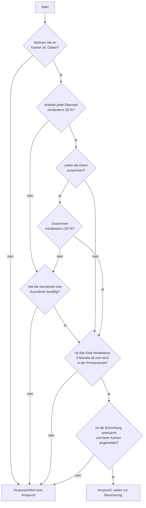

# So funktioniert der Kita-Beitragsrechner St. Gallen

<!--
Legal-Design-Dokument für die Webseite. Aufbau in drei Ebenen (Layering):
  Ebene 1 «Auf einen Blick»      → für alle, 1 Minute
  Ebene 2 «Schritt für Schritt»  → für Familien, die das Ergebnis verstehen wollen
  Ebene 3 «Regeln und Quellen»   → für Juristinnen, Verwaltung und Entwickler
Alle Gesetzeslinks sind am Schluss als Referenzlinks gesammelt. Für die
Webseite nur dort die Pfade anpassen.
Zahlen und Regeln stammen aus challenge/line-to-line-rules.md und
challenge/szenarien.md. Bei Änderungen dort auch hier nachführen.
-->

**Stand:** 7. November 2026 · Gesetz (KiBG) vom 14. Juni 2026 · Verordnung (KiBV) als **Entwurf** in der Vernehmlassung bis 15. November 2026

> **Wichtig:** Der Rechner liefert eine **unverbindliche Schätzung**. Über den Beitrag entscheidet allein die Gemeinde mit einer Verfügung ([Art. 11 KiBG][kibg-11]). Die Beträge stammen aus dem **Entwurf** der Verordnung und können sich noch ändern. Der Rechner speichert keine Angaben.

---

## 1. Auf einen Blick

- **Was der Kanton bezahlt:** Kanton und Gemeinde übernehmen einen Teil der Kosten, wenn Ihr Kind in einer Kita, einer Tagesfamilie oder in der schulergänzenden Betreuung (z. B. Mittagstisch, Tagesstruktur) betreut wird ([Art. 1][kibg-1] und [Art. 3 KiBG][kibg-3]).
- **Wer Anspruch hat:** Sie wohnen im Kanton St. Gallen und arbeiten mindestens 20 %. Wenn Sie mit dem anderen Elternteil zusammenleben, arbeiten Sie beide zusammen mindestens 120 % ([Art. 4 KiBG][kibg-4]).
- **Für welche Kinder:** ab 3 Monaten bis zum Ende der Primarschule ([Art. 4 Abs. 3 KiBG][kibg-4]).
- **Wie viel:** pro Betreuungsstunde ein Betrag zwischen Fr. 0 und Fr. 11. Je tiefer Ihr Einkommen und je jünger Ihr Kind, desto höher der Beitrag ([Art. 14][kibv-14] und [Art. 15 KiBV-Entwurf][kibv-15]).
- **Wie Sie das Geld erhalten:** gar nicht direkt. Die Gemeinde zahlt den Beitrag an die Kita, und die Kita zieht ihn auf Ihrer Rechnung ab ([Art. 12 KiBG][kibg-12]).
- **Was Sie tun müssen:** ein Gesuch bei Ihrer Gemeinde stellen, am besten innert **30 Tagen** nach Betreuungsbeginn. Dann gilt der Beitrag rückwirkend ab dem ersten Betreuungstag ([Art. 9 KiBG][kibg-9]).

---

## 2. Schritt für Schritt: Was der Rechner prüft

Der Rechner arbeitet in zwei Teilen: Zuerst prüft er, **ob** Sie Anspruch haben. Erst dann rechnet er aus, **wie viel**.

### 2.1 Teil A: Haben Sie Anspruch?

Alle vier Bedingungen müssen erfüllt sein. Fehlt eine, ist das Ergebnis «voraussichtlich kein Anspruch». Der Rechner zeigt Ihnen dann, welche Bedingung fehlt.

| Bedingung | Was das heisst | Quelle |
|---|---|---|
| **Wohnsitz** | Die Person, die das Gesuch stellt, hat ihren Wohnsitz im Kanton St. Gallen. | [Art. 4 Abs. 1 KiBG][kibg-4] · Auslegung Team (O8) |
| **Arbeit** | Jeder Elternteil arbeitet mindestens 20 % (angestellt oder selbständig). Leben die Eltern zusammen, kommen sie zusätzlich gemeinsam auf mindestens 120 %. Beispiel: 100 % + 20 % reicht, 120 % + 0 % reicht nicht. | [Art. 4 Abs. 1 lit. a und b KiBG][kibg-4] · Auslegung Team (O3) |
| **Ausnahme** | Arbeiten Sie weniger, kann die Gemeinde in begründeten Fällen eine Ausnahme machen, etwa bei Stellensuche, Ausbildung, Krankheit oder wenn Ihr Kind besondere Förderung braucht. **Das entscheidet die Gemeinde, nicht der Rechner.** | [Art. 4 Abs. 2 KiBG][kibg-4], [Art. 12 KiBV-Entwurf][kibv-12] |
| **Alter des Kindes** | Das Kind ist mindestens 3 Monate alt und hat die Primarschule noch nicht abgeschlossen. | [Art. 4 Abs. 3 KiBG][kibg-4] |
| **Einrichtung** | Die Kita, Tagesfamilie oder Tagesstruktur ist anerkannt und beim Kanton angemeldet. Fragen Sie im Zweifel bei der Einrichtung nach. | [Art. 3 KiBG][kibg-3] |

### 2.2 Teil B: Wie hoch ist der Beitrag?

Der Rechner geht in fünf Schritten vor.

**Schritt 1: Einkommen bestimmen.** Massgebend sind Einkommen und Vermögen gemäss Ihrer letzten definitiven Steuerveranlagung ([Art. 5 KiBG][kibg-5]).
- Leben die Eltern zusammen, zählen beide Einkommen ([Art. 8 Abs. 1 lit. a KiBV-Entwurf][kibv-8]).
- Leben die Eltern getrennt, zählt das Einkommen der Person, die das Gesuch stellt. Dazu kommt das Einkommen einer neuen Partnerin oder eines neuen Partners im gleichen Haushalt, wenn Sie verheiratet sind, in eingetragener Partnerschaft leben oder seit mindestens zwei Jahren zusammenwohnen ([Art. 8 Abs. 1 lit. b und Abs. 2 KiBV-Entwurf][kibv-8]).
- Hat sich Ihr Einkommen seit der letzten Veranlagung um mindestens 25 % verändert, können Sie verlangen, dass das aktuelle Einkommen zählt ([Art. 5 Abs. 4 KiBG][kibg-5], [Art. 11 KiBV-Entwurf][kibv-11]).

**Schritt 2: Höchstbeitrag pro Stunde bestimmen.** Er hängt vom Alter des Kindes und von der Art der Betreuung ab ([Art. 14 Abs. 1–3 KiBV-Entwurf][kibv-14]):

| Höchstbeitrag pro Stunde | Kita | Tagesfamilie | Schulergänzende Betreuung |
|---|---|---|---|
| Kind unter 18 Monaten | Fr. 11.00 | Fr. 8.30 | – |
| Kind ab 18 Monaten bis zur Einschulung | Fr. 7.50 | Fr. 5.50 | – |
| Eingeschultes Kind bis Ende Primarschule | Fr. 7.50 | Fr. 5.50 | Fr. 5.50 |

**Schritt 3: Höchstbeitrag an das Einkommen anpassen.** Bis zu einem Einkommen von Fr. 40'000 erhalten Sie den vollen Höchstbeitrag. Ab Fr. 154'000 erhalten Sie nichts. Dazwischen sinkt der Beitrag gleichmässig, wie auf einer geraden Linie ([Art. 6 Abs. 1 KiBG][kibg-6], [Art. 15][kibv-15] und [Anhang KiBV-Entwurf][kibv-anhang]):

| Ihr Einkommen | Sie erhalten vom Höchstbeitrag |
|---|---|
| bis Fr. 40'000 | 100 % |
| Fr. 68'500 | 75 % |
| Fr. 97'000 | 50 % |
| Fr. 125'500 | 25 % |
| ab Fr. 154'000 | 0 % |

**Schritt 4: Mit den Betreuungsstunden multiplizieren.** Pro Tag zählen höchstens 12 Stunden, pro Woche höchstens 5 Tage ([Art. 14 Abs. 4 KiBV-Entwurf][kibv-14]).

**Schritt 5: Auf die Kosten begrenzen.** Der Beitrag ist nie höher als das, was Sie der Kita tatsächlich bezahlen ([Art. 6 Abs. 2 KiBG][kibg-6]). Der Rechner zeigt Ihnen am Schluss, was nach Abzug des Beitrags für Sie übrig bleibt ([Art. 12 Abs. 2 KiBG][kibg-12]).

Für Interessierte: die Formel aus der Verordnung

**B = (MaxV + Z1) × (1 − (ME − MinmE) / (MaxmE − MinmE)) + Z2**

| Zeichen | Bedeutung | Wert |
|---|---|---|
| B | Beitrag pro Kind und Betreuungsstunde | Ergebnis |
| MaxV | Höchstbeitrag pro Stunde | Tabelle in Schritt 2 |
| ME | Ihr massgebendes Einkommen und Vermögen | Ihre Angabe |
| MinmE | kleinstes massgebendes Einkommen | Fr. 40'000 |
| MaxmE | höchstes massgebendes Einkommen | Fr. 154'000 |
| Z1, Z2 | freiwillige Zusatzbeiträge Ihrer Gemeinde (Z1 vom Einkommen abhängig, Z2 nicht) | je nach Gemeinde |

Quelle: [Art. 13 und Anhang KiBV-Entwurf][kibv-anhang]. Der Klammerausdruck wird auf 0 bis 1 begrenzt, denn so verlangt es [Art. 15 KiBV-Entwurf][kibv-15].

### 2.3 Wer macht was?

| | Sie (Eltern) | Kita / Einrichtung | Gemeinde | Kanton |
|---|---|---|---|---|
| **1. Vor Betreuungsbeginn** | Rechner nutzen, Einrichtung wählen | ist beim Kanton angemeldet ([Art. 3 Abs. 3 KiBG][kibg-3]) | – | prüft und bestätigt die Anmeldung der Einrichtung |
| **2. Innert 30 Tagen** | Gesuch bei der Gemeinde stellen, über die elektronische Plattform ([Art. 9 KiBG][kibg-9]) | bestätigt das Betreuungsverhältnis ([Art. 10 KiBG][kibg-10]) | – | – |
| **3. Entscheid** | – | – | prüft den Anspruch und verfügt den Beitrag, meist für 12 Monate ([Art. 11 KiBG][kibg-11]) | – |
| **4. Jeden Monat** | bezahlt die Rechnung abzüglich Beitrag | meldet die Betreuung und zieht den Beitrag ab ([Art. 12][kibg-12], [Art. 15 KiBG][kibg-15]) | zahlt den Beitrag an die Kita | zahlt der Gemeinde die Hälfte zurück ([Art. 18 KiBG][kibg-18]) |
| **5. Wenn sich etwas ändert** | meldet Änderungen sofort ([Art. 14 Abs. 2 KiBG][kibg-14]) | meldet Änderungen bei der Betreuung | passt die Verfügung an | – |

> **Achtung:** Wer Änderungen nicht meldet (z. B. tieferes Pensum oder Umzug), muss zu Unrecht bezogene Beiträge zurückzahlen. Die Gemeinde kann sie innert fünf Jahren seit dem rechtskräftigen Entscheid zurückfordern ([Art. 13 KiBG][kibg-13]).

---

## 3. Ein Beispiel: Familie Keller

Diese Familie ist erfunden. Sie entspricht dem Testfall P1 in unserem Code.

> **Familie Keller** wohnt in St. Gallen. Die Mutter arbeitet 100 % und verdient Fr. 60'000, der Vater arbeitet 40 % und verdient Fr. 37'000. Tochter Lina ist 12 Monate alt und geht zwei Tage pro Woche in die Kita, je 10 Stunden, also 80 Stunden im Monat. Die Kita kostet Fr. 13 pro Stunde, also Fr. 1'040 im Monat.

**Hat Familie Keller Anspruch? Ja.**
- Sie wohnen im Kanton St. Gallen. ✓ ([Art. 4 Abs. 1 KiBG][kibg-4])
- Beide Eltern arbeiten mindestens 20 %, zusammen 140 %, also mehr als 120 %. ✓ ([Art. 4 Abs. 1 lit. a und b KiBG][kibg-4])
- Lina ist älter als 3 Monate. ✓ ([Art. 4 Abs. 3 KiBG][kibg-4])
- Die Kita ist anerkannt und angemeldet. ✓ ([Art. 3 KiBG][kibg-3])

**Wie viel erhält sie?**

| Schritt | Rechnung | Ergebnis | Quelle |
|---|---|---|---|
| Einkommen | 60'000 + 37'000 | Fr. 97'000 | [Art. 8 Abs. 1 lit. a KiBV-Entwurf][kibv-8] |
| Anteil vom Höchstbeitrag | 97'000 liegt genau in der Mitte zwischen 40'000 und 154'000 | 50 % | [Art. 15][kibv-15], [Anhang KiBV-Entwurf][kibv-anhang] |
| Höchstbeitrag | Kita, Kind unter 18 Monaten | Fr. 11.00 pro Stunde | [Art. 14 Abs. 1 lit. a KiBV-Entwurf][kibv-14] |
| Beitrag pro Stunde | 11.00 × 50 % | Fr. 5.50 | [Anhang KiBV-Entwurf][kibv-anhang] |
| Stunden | 80 Stunden an 8 Tagen, weniger als 8 × 12 | 80 Stunden | [Art. 14 Abs. 4 KiBV-Entwurf][kibv-14] |
| **Beitrag pro Monat** | 5.50 × 80, weniger als die Kosten von Fr. 1'040 | **Fr. 440** | [Art. 6 Abs. 2 KiBG][kibg-6] |
| **Familie Keller bezahlt noch** | 1'040 − 440 | **Fr. 600** | [Art. 12 Abs. 2 KiBG][kibg-12] |
| davon bezahlt der Kanton / die Gemeinde | je die Hälfte | je Fr. 220 | [Art. 18 KiBG][kibg-18] |

**In einfachen Worten:** Familie Keller erhält voraussichtlich **Fr. 440 pro Monat**. Die Kita zieht diesen Betrag direkt von der Rechnung ab, sodass die Familie noch Fr. 600 statt Fr. 1'040 bezahlt.

**Was Familie Keller wissen sollte:**
- Ab dem 1. März 2029 ist Lina 18 Monate alt. Dann sinkt der Höchstbeitrag auf Fr. 7.50, und der Beitrag beträgt noch Fr. 300 pro Monat ([Art. 14 Abs. 2 KiBV-Entwurf][kibv-14]).
- Wenn ihre Gemeinde freiwillig Zusatzbeiträge zahlt, erhält sie mehr ([Art. 20 KiBG][kibg-20]).
- Massgebend ist am Ende die Verfügung der Gemeinde.

### Zum Vergleich: drei andere Familien

| Familie | Situation | Ergebnis | Warum |
|---|---|---|---|
| **Alleinerziehende Mutter** | arbeitet 50 %, Einkommen Fr. 30'000, Sohn 2½ Jahre, Tagesfamilie, 108 Stunden | **Fr. 594** pro Monat | Einkommen unter Fr. 40'000, daher voller Höchstbeitrag von Fr. 5.50 ([Art. 15 Abs. 1 KiBV-Entwurf][kibv-15]) |
| **Paar mit hohem Einkommen** | beide 100 %, Einkommen zusammen Fr. 125'500, Sohn 2 Jahre, Kita, 200 Stunden | **Fr. 375** pro Monat | 25 % von Fr. 7.50 = Fr. 1.875 pro Stunde ([Art. 14 Abs. 2][kibv-14], [Art. 15 KiBV-Entwurf][kibv-15]) |
| **Paar, nur ein Elternteil arbeitet** | 120 % und 0 % | **voraussichtlich kein Anspruch**, ausser die Gemeinde bewilligt eine Ausnahme | Jeder Elternteil muss mindestens 20 % arbeiten ([Art. 4 Abs. 1 und 2 KiBG][kibg-4], Auslegung Team O3) |

---

## 4. Was der Rechner (noch) nicht kann

Wir sagen offen, wo der Rechner an Grenzen stösst. Diese Fälle muss die Gemeinde prüfen.

| Thema | Was der Rechner macht | Warum |
|---|---|---|
| **Ausnahmen beim Pensum** | Er fragt, ob die Gemeinde eine Ausnahme bewilligt hat, entscheidet aber nicht selbst. | Das ist ein Ermessensentscheid der Gemeinde ([Art. 4 Abs. 2 KiBG][kibg-4], [Art. 12 KiBV-Entwurf][kibv-12]). |
| **Massgebendes Einkommen** | Sie geben das Einkommen selbst ein. Der Rechner berechnet es nicht aus der Steuererklärung. | Die Berechnung steht in einer anderen Verordnung (V EG-KVG, sGS 331.111), auf die [Art. 9 KiBV-Entwurf][kibv-9] verweist. |
| **Mehr als 5 Tage pro Woche** | Er prüft diese Grenze nicht. Bei Betreuung am Samstag kann das Ergebnis zu hoch sein. | Der Rechner arbeitet mit Monatswerten. Die Umrechnung von Wochen auf Monate regelt der Text nicht ([Art. 14 Abs. 4 KiBV-Entwurf][kibv-14]). |
| **Module und Monatspauschalen** | nicht berücksichtigt | Das soll das Amt für Soziales in Richtlinien regeln, die noch nicht vorliegen ([Art. 14 Abs. 5 KiBV-Entwurf][kibv-14]). |
| **Zusatzbeiträge der Gemeinde** | nur, wenn Sie die Werte Ihrer Gemeinde eingeben | Jede Gemeinde entscheidet selbst, ob und wie viel sie zusätzlich zahlt ([Art. 20 KiBG][kibg-20], [Art. 24 KiBV-Entwurf][kibv-24]). |
| **Fristen und Daten** | Der Rechner schätzt den Beitrag pro Monat, berechnet aber nicht, ab wann er gilt. | Das hängt vom Datum des Gesuchs ab ([Art. 9 KiBG][kibg-9], [Art. 25 KiBV-Entwurf][kibv-25]). |
| **Vollzugsbeginn** | rechnet mit dem Platzhalter 1. August 2028 | Die Regierung hat das Datum noch nicht festgelegt; geplant ist Mitte 2028 (KiBG Ziff. IV, [Umsetzungsseite des Kantons][sg-umsetzung]). |

---

## 5. Regeln und Quellen (für Fachleute)

Diese Ebene richtet sich an Juristinnen und Juristen, die Verwaltung und Entwicklerinnen und Entwickler. Jede Regel zeigt, woher sie stammt und wie verlässlich sie ist.

### 5.1 Wie sicher ist eine Regel?

| Kennzeichnung | Bedeutung |
|---|---|
| **Gesetz** | steht so im KiBG vom 14. Juni 2026 (vom Volk angenommen, noch nicht in Kraft) |
| **Verordnung (Entwurf)** | steht so im Entwurf der KiBV (RRB 2026/733), kann sich nach der Vernehmlassung noch ändern |
| **Auslegung Team** | Der Text ist unklar. Wir haben uns mit Begründung für eine Lesart entschieden (O = offene Frage im [Regelinventar][regelinventar]). |
| **Annahme Team** | Der Text schweigt. Wir haben eine Annahme getroffen, damit der Rechner rechnen kann (A = Annahme im [Szenarienkatalog][szenarien]). |
| **Ermessen Behörde** | Das entscheidet ein Mensch bei der Behörde. Im Rechner ist es eine Eingabe, nie eine Berechnung. |

### 5.2 Regeltabelle

| Nr. | Wenn … | dann … | Quelle | Kennzeichnung | Im Code |
|---|---|---|---|---|---|
| R1 | die gesuchstellende Person Wohnsitz im Kanton hat | ist die Wohnsitzbedingung erfüllt | [Art. 4 Abs. 1 KiBG][kibg-4] | Gesetz + Auslegung Team (O8) | `kibg_wohnsitz_erfuellt` |
| R2 | jeder Elternteil ≥ 20 % arbeitet **und**, bei gemeinsamem Haushalt, beide zusammen ≥ 120 % | ist die Beschäftigungsbedingung erfüllt | [Art. 4 Abs. 1 lit. a, b KiBG][kibg-4] | Gesetz + Auslegung Team (O3, kumulativ) | `kibg_beschaeftigung_erfuellt` |
| R3 | die Gemeinde vom Mindestpensum entbindet | gilt R2 als ersetzt | [Art. 4 Abs. 2 KiBG][kibg-4], [Art. 12 KiBV][kibv-12] | Ermessen Behörde | `kibg_ausnahme_bewilligt` (Eingabe) |
| R4 | das Kind ≥ 3 Monate alt ist und die Primarschule nicht abgeschlossen hat | ist die Altersbedingung erfüllt | [Art. 4 Abs. 3 KiBG][kibg-4] | Gesetz; Stichtag Monatserster: Annahme A1 | `kibg_alter_erfuellt` |
| R5 | die Einrichtung anerkannt **und** angemeldet ist | ist die Einrichtung berechtigt | [Art. 3 KiBG][kibg-3] | Gesetz; Anerkennung = Entscheid Behörde | `kibg_einrichtung_berechtigt` |
| R6 | R1, (R2 oder R3), R4 und R5 erfüllt sind | besteht Anspruch | [Art. 3–4 KiBG][kibg-4] | Gesetz | `kibg_anspruch` |
| R7 | die Eltern im gemeinsamen Haushalt leben | zählt das Einkommen beider | [Art. 8 Abs. 1 lit. a KiBV][kibv-8] | Verordnung (Entwurf) | `kibg_massgebendes_einkommen` |
| R8 | die Eltern getrennt leben | zählt das Einkommen der gesuchstellenden Person + der Partnerin oder des Partners in gefestigter Lebensgemeinschaft | [Art. 8 Abs. 1 lit. b, Abs. 2 KiBV][kibv-8] | Verordnung (Entwurf) | `kibg_gefestigte_lebensgemeinschaft` |
| R9 | das aktuelle Einkommen auf Antrag um ≥ 25 % abweicht (nach oben oder unten) | zählt das aktuelle Einkommen | [Art. 5 Abs. 4 KiBG][kibg-5], [Art. 11 KiBV][kibv-11] | Verordnung (Entwurf) + Auslegung Team (O12) | `kibg_antrag_aktuelle_gegebenheiten` |
| R10 | das Kind unter 18 Monate alt ist / ab 18 Monaten / eingeschult ist | gilt der Höchstbeitrag gemäss Tabelle | [Art. 14 Abs. 1–3 KiBV][kibv-14] | Verordnung (Entwurf); Grenze bei genau 18 Monaten: Auslegung Team (O2) | `kibg_hoechstbeitrag` |
| R11 | das Einkommen ≤ 40'000 / zwischen / ≥ 154'000 ist | beträgt der Einkommensfaktor 1 / linear / 0 | [Art. 15][kibv-15], [Anhang KiBV][kibv-anhang] | Verordnung (Entwurf) | `kibg_einkommensfaktor` |
| R12 | Betreuungsstunden eingegeben sind | zählen höchstens 12 Stunden pro Betreuungstag | [Art. 14 Abs. 4 KiBV][kibv-14] | Verordnung (Entwurf); 5-Tage-Grenze nicht geprüft: Annahme A3 | `kibg_subventionierte_stunden` |
| R13 | der Mindestbeitrag berechnet ist | ist er höchstens so hoch wie die Kosten | [Art. 6 Abs. 2 KiBG][kibg-6] | Gesetz; Rundung auf 5 Rappen: Annahme A4 | `kibg_mindestbeitrag` |
| R14 | die Gemeinde Zusatzbeiträge zahlt | wird zuerst der Zusatzbeitrag gekürzt, falls die Summe die Kosten übersteigt | [Art. 20 Abs. 3 KiBG][kibg-20] | Gesetz + Annahme A2 | `kibg_beitrag_total` |
| R15 | Z2 einkommensunabhängig ist | wird Z2 auch über Fr. 154'000 ausgerichtet | [Art. 15 Abs. 2][kibv-15], [Art. 24 KiBV][kibv-24] | Auslegung Team (O4) | `kibg_zusatzbeitrag` |
| R16 | ein Mindestbeitrag ausgerichtet wird | tragen Kanton und Gemeinde je die Hälfte | [Art. 18 Abs. 1 KiBG][kibg-18] | Gesetz | `kibg_anteil_kanton`, `kibg_anteil_gemeinde` |
| R17 | der Beitrag feststeht | zahlen die Eltern Kosten minus Beitrag | [Art. 12 Abs. 2 KiBG][kibg-12] | Gesetz | `kibg_restkosten_eltern` |

### 5.3 Unklarheiten und wie wir sie gelöst haben

| Nr. | Frage | Unsere Lösung | Begründung |
|---|---|---|---|
| O2 | Ein Kind mit genau 18 Monaten ist weder «unter» noch «über» 18 Monaten. | Der höhere Ansatz gilt die vollen ersten 18 Lebensmonate. | schliesst die Lücke zugunsten der Familie |
| O3 | Genügen bei Paaren 120 % zusammen, auch wenn ein Elternteil nicht arbeitet? | Nein: Jeder Elternteil braucht mindestens 20 %. | Wortlaut, Systematik (120 = 100 + 20), Rechtsgleichheit ([Art. 8 BV][bv-8]), Zweck |
| O4 | Gilt der einkommensunabhängige Zusatzbeitrag Z2 auch über Fr. 154'000? | Ja | Z2 ist per Definition einkommensunabhängig ([Art. 24 KiBV][kibv-24]). |
| O5 | Wie wird das massgebende Einkommen berechnet? | vorerst Eingabe | Die V EG-KVG gehört nicht zu den Unterlagen. |
| O6 | Weicht der Schlusstext des Gesetzes von der ersten Lesung ab? | **offen** | Uns liegt nur die Fassung der ersten Lesung vom 16. September 2025 vor. |
| O7 | Wie wird «höchstens 5 Tage pro Woche» auf einen Monat umgerechnet? | **offen**, Grenze vorerst nicht geprüft | Text und Richtlinien schweigen. |
| O8 | Welcher Elternteil muss bei Getrenntleben im Kanton wohnen? | die gesuchstellende Person; zuständig ist ihre Wohngemeinde | passt zur Zuständigkeitsregel in [Art. 2 KiBV][kibv-2] |
| O10 | Wer stellt bei alternierender Obhut das Gesuch? | Jeder Elternteil für die eigenen Obhutstage | [Art. 7 KiBV][kibv-7] knüpft an die faktische Obhut an. |
| O12 | Zählt die 25-%-Abweichung auch nach oben? | Ja, in beide Richtungen | Der Wortlaut spricht neutral von «Abweichung». |

Die vollständige Liste mit allen Begründungen steht im [Regelinventar][regelinventar]. Diese Fragen bringen wir auch in die Vernehmlassung zur Verordnung ein (Frist 15. November 2026).

---

## 6. Häufige Fragen

**Ist das Ergebnis verbindlich?**
Nein. Es ist eine Schätzung. Verbindlich ist nur die Verfügung Ihrer Gemeinde ([Art. 11 KiBG][kibg-11]).

**Ab wann gelten die neuen Regeln?**
Das Gesetz wurde am 14. Juni 2026 angenommen. Den Start legt die Regierung fest; geplant ist Mitte 2028 ([Umsetzungsseite des Kantons][sg-umsetzung]). Bis dahin gilt das bisherige Gesetz vom 29. November 2020.

**Was speichert der Rechner?**
Nichts. Der Rechner speichert Ihre Angaben nicht. Für das echte Gesuch braucht die Gemeinde mehr Daten, zum Beispiel Ihre AHV-Nummer und Steuerdaten ([Art. 8 KiBG][kibg-8], [Art. 21 KiBV-Entwurf][kibv-21]). Der Rechner fragt nur, was er für die Schätzung braucht.

**Ich arbeite weniger als 20 %. Habe ich keine Chance?**
Doch, vielleicht. Die Gemeinde kann eine Ausnahme machen, zum Beispiel wenn Sie eine Stelle suchen, eine Ausbildung machen, krank sind oder Ihr Kind besondere Förderung braucht ([Art. 4 Abs. 2 KiBG][kibg-4], [Art. 12 KiBV-Entwurf][kibv-12]). Fragen Sie bei Ihrer Gemeinde nach.

**Was passiert, wenn ich das Gesuch zu spät stelle?**
Dann erhalten Sie den Beitrag erst ab dem Tag des Gesuchs, nicht rückwirkend ([Art. 9 Abs. 2 KiBG][kibg-9]). Ausnahme beim Start des neuen Systems: Gesuche innert drei Monaten nach Vollzugsbeginn gelten rückwirkend ab Vollzugsbeginn ([Art. 25 KiBV-Entwurf][kibv-25]).

**Mein Kind geht in eine Kita in einem anderen Kanton. Geht das?**
Ja, wenn sich die Einrichtung beim Kanton St. Gallen angemeldet hat ([Art. 3 KiBV-Entwurf][kibv-3]).

---

## 7. Begriffe

| Begriff | Bedeutung |
|---|---|
| **Erziehungsberechtigte** | die Personen, die das Kind in ihrer Obhut haben und den Beitrag beantragen, meistens die Eltern ([Art. 2 KiBG][kibg-1]) |
| **Massgebendes Einkommen und Vermögen** | eine Zahl aus Ihrer Steuerveranlagung, die zeigt, wie viel Sie wirtschaftlich leisten können ([Art. 5 KiBG][kibg-5]) |
| **Beschäftigungsgrad** | Ihr Arbeitspensum in Prozent einer Vollzeitstelle |
| **Gefestigte Lebensgemeinschaft** | Ehe, eingetragene Partnerschaft oder mindestens zwei Jahre im gleichen Haushalt ([Art. 8 Abs. 2 KiBV-Entwurf][kibv-8]) |
| **Mindestbeitrag** | der Beitrag, den Kanton und Gemeinde gemeinsam zahlen müssen ([Art. 20 Abs. 1 KiBG][kibg-20]) |
| **Zusatzbeitrag** | freiwilliges Geld Ihrer Gemeinde zusätzlich zum Mindestbeitrag ([Art. 20 Abs. 2 KiBG][kibg-20]) |
| **Verfügung** | der schriftliche, verbindliche Entscheid der Gemeinde über Ihren Beitrag ([Art. 11 KiBG][kibg-11]) |
| **Vernehmlassung** | Phase, in der Gemeinden, Verbände und Private den Entwurf der Verordnung kommentieren können |

---

## 8. Quellen

| Erlass | Fassung, die der Rechner verwendet | Status |
|---|---|---|
| Gesetz über Beiträge für familien- und schulergänzende Kinderbetreuung (**KiBG**), sGS 221.1 | [Gesetz.pdf][kibg-pdf] (Ergebnis der ersten Lesung, 16. September 2025) | in der Volksabstimmung vom 14. Juni 2026 angenommen ([Medienmitteilung][sg-abstimmung]); Vollzugsbeginn offen |
| Verordnung über Beiträge für familien- und schulergänzende Kinderbetreuung (**KiBV**) | [Verordnung.pdf][kibv-pdf] (RRB 2026/733) | **Entwurf**, Vernehmlassung bis 15. November 2026 ([Mitteilung des Kantons][sg-vernehmlassung]) |
| Weitere Materialien | [Umsetzung der KiBG-Revision][sg-umsetzung], [FAQ des Kantons][sg-faq], [Unterlagen des Kantonsrats][ratsinfo] | – |

> **Hinweis zur Gesetzessammlung:** Unter sGS 221.1 steht in der [Gesetzessammlung][gesetzessammlung] bis zum Vollzugsbeginn noch das **bisherige** Gesetz vom 29. November 2020. Unsere Artikel-Links führen deshalb auf die Seiten der PDF-Fassungen, mit denen der Rechner arbeitet.

<!-- ===================================================================
     Linkziele. Für die Webseite nur hier anpassen.
     #page=N öffnet die PDF-Seite mit dem Artikel (in den meisten Browsern).
     Sobald die neue Fassung in der Gesetzessammlung publiziert ist, die
     kibg-*-Links auf die Artikel-Anker der Gesetzessammlung umstellen.
     =================================================================== -->

[kibg-pdf]: ../challenge/Gesetz.pdf
[kibg-1]: ../challenge/Gesetz.pdf#page=1
[kibg-3]: ../challenge/Gesetz.pdf#page=1
[kibg-4]: ../challenge/Gesetz.pdf#page=2
[kibg-5]: ../challenge/Gesetz.pdf#page=2
[kibg-6]: ../challenge/Gesetz.pdf#page=2
[kibg-8]: ../challenge/Gesetz.pdf#page=3
[kibg-9]: ../challenge/Gesetz.pdf#page=3
[kibg-10]: ../challenge/Gesetz.pdf#page=3
[kibg-11]: ../challenge/Gesetz.pdf#page=3
[kibg-12]: ../challenge/Gesetz.pdf#page=4
[kibg-13]: ../challenge/Gesetz.pdf#page=4
[kibg-14]: ../challenge/Gesetz.pdf#page=4
[kibg-15]: ../challenge/Gesetz.pdf#page=4
[kibg-18]: ../challenge/Gesetz.pdf#page=5
[kibg-20]: ../challenge/Gesetz.pdf#page=5

[kibv-pdf]: ../challenge/Verordnung.pdf
[kibv-2]: ../challenge/Verordnung.pdf#page=1
[kibv-3]: ../challenge/Verordnung.pdf#page=1
[kibv-7]: ../challenge/Verordnung.pdf#page=2
[kibv-8]: ../challenge/Verordnung.pdf#page=2
[kibv-9]: ../challenge/Verordnung.pdf#page=2
[kibv-11]: ../challenge/Verordnung.pdf#page=3
[kibv-12]: ../challenge/Verordnung.pdf#page=3
[kibv-14]: ../challenge/Verordnung.pdf#page=3
[kibv-15]: ../challenge/Verordnung.pdf#page=4
[kibv-21]: ../challenge/Verordnung.pdf#page=5
[kibv-24]: ../challenge/Verordnung.pdf#page=7
[kibv-25]: ../challenge/Verordnung.pdf#page=7
[kibv-anhang]: ../challenge/Verordnung.pdf#page=8

[bv-8]: https://www.fedlex.admin.ch/eli/cc/1999/404/de#art_8
[sg-umsetzung]: https://www.sg.ch/gesundheit-soziales/soziales/kinder-und-jugendliche/kindertagesbetreuung/kinderbetreuungsgesetz/umsetzung-der-kibg-revision.html
[sg-abstimmung]: https://www.sg.ch/news/sgch_allgemein/2026/06/ja-zum-totalrevidierten-kinderbetreuungsgesetz.html
[sg-vernehmlassung]: https://www.sg.ch/news/sgch_allgemein/2026/10/verordnung-familien--und-schulergaenzende-kinderbetreuung.html
[sg-faq]: https://www.sg.ch/gesundheit-soziales/soziales/kinder-und-jugendliche/kindertagesbetreuung/kinderbetreuungsgesetz/umsetzung-der-kibg-revision/_jcr_content/Par/sgch_downloadlist_15/DownloadListPar/sgch_download.ocFile/FAQ%20KiBG%20Totalrevision.pdf
[ratsinfo]: https://www.ratsinfo.sg.ch/gremium/468/geschaefte/6284?documentId=25789
[gesetzessammlung]: https://www.gesetzessammlung.sg.ch/app/de/texts_of_law/221.1
[regelinventar]: ../challenge/line-to-line-rules.md
[szenarien]: ../challenge/szenarien.md

---

## Anhang für das Team: angewendete Legal-Design-Methoden

*Nicht für die Webseite. Für den Bericht und die Präsentation (Kurs Legal Design, HSG 2026).*

| Methode (Kurs) | Wo im Dokument | Zweck |
|---|---|---|
| **Layering** (erste Ebene als Zusammenfassung, zweite mit Details; Beispiel Juro-Datenschutzerklärung, Folien «Design Methods for Law») | Abschnitte 1 → 2 → 5, Formel eingeklappt | Familien lesen nur Ebene 1–2, Fachleute springen zu Ebene 3 |
| **Strukturierte Überschriften** für strategisches Lesen | jede Überschrift ist eine Frage oder Aufgabe | Information schnell finden |
| **«How, not a list»**: Schritt-für-Schritt-Anleitung und Erwartungen (Beispiel Bupa) | 2.2 (fünf Schritte), 2.3, FAQ | zeigt, was Sie tun müssen und was dann passiert |
| **Entscheidungsbaum** | 2.1 | macht die kumulativen Bedingungen von Art. 4 KiBG sichtbar |
| **Swimlane** (WorldCC-Bibliothek der Vertragsdesign-Patterns) | 2.3 «Wer macht was?» | Rollen von Eltern, Einrichtung, Gemeinde und Kanton im zeitlichen Ablauf |
| **Persona und Szenario** | 3 (Familie Keller + Vergleichsfamilien) | Recht an einem konkreten Fall verständlich machen; zugleich Testfall P1 |
| **Plain Language** | kurze Sätze, aktive Form, Sie-Ansprache, Fachbegriffe im Glossar | Verständlichkeit |
| **Just-in-time-Hinweise** | Hinweise zur 18-Monate-Grenze und zur Meldepflicht | Information dort, wo sie gebraucht wird |
| **Transparenz über Grenzen** | 4 und 5.1 (Kennzeichnung der Verlässlichkeit) | Vertrauen; klar trennen zwischen Gesetz, Entwurf, Auslegung und Annahme |

**Vorschlag für die Evaluation** (Folien «Ideation, prototyping and evaluation»):
- **Cognitive Walkthrough** mit 3–5 Eltern, Think-aloud-Methode. Aufgaben: (1) «Hat eine Familie mit 120 % / 0 % Anspruch?» (Verständnis), (2) «In welchem Artikel steht die Altersgrenze?» (Auffindbarkeit), (3) «Was müssen Sie tun, damit der Beitrag ab dem ersten Kita-Tag gilt?» (Umsetzbarkeit).
- **Kennzahlen:** Erfolgsquote pro Aufgabe, Zeit bis zur Antwort, Anzahl richtiger Antworten im Vergleich zur reinen Lektüre von KiBG und KiBV (Baseline).
- **Pain Points:** Testpersonen markieren unklare und hilfreiche Formulierungen auf einem Ausdruck.
- **Expertenreview:** Juristin oder Jurist prüft die Regeltabelle (5.2) Zeile für Zeile gegen den Text.
